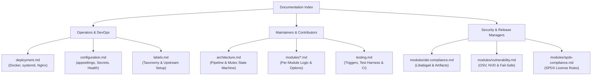

# Documentation

Welcome to the reference documentation for `abaci-bot`.

This directory contains architectural specifications, deployment guides, operational manuals, label taxonomies, and per-module reference documentation.

---

## Reading Paths

Depending on your role and task, follow the recommended reading path below:

---

## Core System Guides

| Document | Purpose and Scope |
|---|---|
| [`architecture.md`](architecture.md) | Pipeline event flow, module execution priority, LabelMutexEngine state machine, and background workers. |
| [`deployment.md`](deployment.md) | System requirements, container deployment, systemd unit templates, reverse proxy setup, GitHub App permissions, and rollback. |
| [`configuration.md`](configuration.md) | Configuration hierarchy, whole-line comment conventions, environment variables, secret management, and `/health` verification. |
| [`labels.md`](labels.md) | Exhaustive label taxonomy, official vs bot extensions, mutex groups, upstream `gh` setup commands, and migration procedures. |
| [`testing.md`](testing.md) | Test harness, webhook trigger matrix, local testing procedures, coverage requirements, and sandbox validation. |

---

## Module Reference Documentation

Each module has a dedicated specification detailing triggers, decision trees, managed labels, configuration options, and failure semantics:| Module | Priority | Purpose | Managed Labels | Documentation |
|---|---|---|---|---|
| `WorkflowStateModule` | 10 | Tracks PR review progression and merge completion | `Workflow: In Dev`, `Workflow: Ready For Review`, `Workflow: In Review`, `Workflow: Blocked`, `Workflow: Complete`, `Commits: Updated` | [`modules/workflow-state.md`](modules/workflow-state.md) |
| `StaleUnstaleModule` | 12 | Removes `Status: Stale` on human activity | Strips `Status: Stale` | [`modules/stale-lifecycle.md`](modules/stale-lifecycle.md) |
| `ShinyNewPrModule` | 15 | Highlights newly opened pull requests | `Status: New` | [`modules/workflow-state.md`](modules/workflow-state.md#shiny-new-pr-governance-shinynewprmodule) |
| `UserContributionModule` | 20 | Classifies student vs external community contributions | `Community: Student contribution`, `Community: Contribution` | [`labels.md`](labels.md#1-managed-label-taxonomy) |
| `TargetClassificationModule` | 25 | Classifies release target stream | `Target: Rolling`, `Target: LTS` | [`modules/target-classification.md`](modules/target-classification.md) |
| `BuildSystemAnalysisModule` | 30 | Classifies build systems in RPM specs | `BuildSystem: autotools`, `cmake`, `meson`, `rust`, etc., `CI` | [`modules/build-system.md`](modules/build-system.md) |
| `ChangeTypeClassificationModule` | 35 | Identifies packaging, docs, or infra diffs | `Type: Packaging`, `Type: Documentation`, `Type: Infrastructure`, `Type: Frontend` | [`modules/change-type.md`](modules/change-type.md) |
| `AiAssistanceModule` | 40 | Detects AI assistance disclosure in PR bodies | `AI Assistance` | [`modules/ai-assistance.md`](modules/ai-assistance.md) |
| `SpdxComplianceModule` | 60 | Validates spec license expressions | `Compliance: License Issue` | [`modules/spdx-compliance.md`](modules/spdx-compliance.md) |
| `VulnerabilityModule` | 70 | Correlates CVE mentions with OSV/NVD | `Severity: 1-4`, `Vulnerability: Detected`, `Fixed-Pending`, `Resolved`, `Dismissed` | [`modules/vulnerability.md`](modules/vulnerability.md) |
| `RebuildImpactModule` | 80 | Analyzes reverse dependency impact | `Rebuild: 0` through `Rebuild: 5001+`, `Workflow: Blocked` | [`modules/rebuild-impact.md`](modules/rebuild-impact.md) |
| `AbiComplianceModule` | 85 | Verifies binary ABI backwards compatibility | `Impact: ABI`, `Impact: Breaking Change`, `Status: ABI Unverified` | [`modules/abi-compliance.md`](modules/abi-compliance.md) |

> Defaults and label values are owned by `Options/*.cs` and `Services/GitHubLabels.cs`.
> The tables in these pages are references, not a second source of truth: contract tests
> keep `appsettings.demo.jsonc` and `docs/labels.md` aligned with the code.
