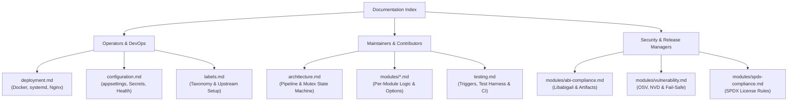

# Documentation

Welcome to the reference documentation for `abaci-bot`.

This directory contains architectural specifications, deployment guides, operational manuals, label taxonomies, and per-module reference documentation.

---

## Reading Paths

Depending on your role and task, follow the recommended reading path below:

---

## Core System Guides

| Document | Purpose and Scope |
|---|---|
| [`architecture.md`](architecture.md) | Pipeline event flow, module execution priority, LabelMutexEngine state machine, and background workers. |
| [`deployment.md`](deployment.md) | System requirements, container deployment, systemd unit templates, reverse proxy setup, GitHub App permissions, and rollback. |
| [`configuration.md`](configuration.md) | Configuration hierarchy, whole-line comment conventions, environment variables, secret management, and `/health` verification. |
| [`labels.md`](labels.md) | Exhaustive label taxonomy, official vs bot extensions, mutex groups, upstream `gh` setup commands, and migration procedures. |
| [`testing.md`](testing.md) | Test harness, webhook trigger matrix, local testing procedures, coverage requirements, and sandbox validation. |

---

## Module References

Per-module pages live in [`modules/`](modules/). The canonical list with priorities,
managed labels, and links to each page is maintained once in the root README:
[Capabilities & Modules](../README.md#capabilities--modules).

> Defaults and label values are owned by `Options/*.cs` and `Services/GitHubLabels.cs`.
> The tables in these pages are references, not a second source of truth: contract tests
> keep `appsettings.demo.jsonc` and `docs/labels.md` aligned with the code.
