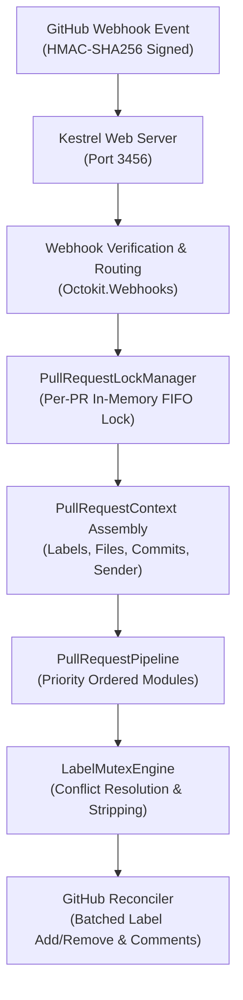

# System Architecture

`abaci-bot` is a webhook-driven governance bot and background daemon built for openEuler / openRuyi package repositories and related infrastructure.

---

## 1. Event Ingestion Pipeline

Incoming GitHub webhook events are authenticated, parsed, and dispatched through the pipeline:

### Locking Strategy
To prevent race conditions during rapid event arrivals (such as push batches, synchronized reviews, or automated bots), `PullRequestLockManager` guarantees serialized execution per PR using keyed async semaphore locks (`owner/repo#prNumber`).

---

## 2. Module Priority Order

Each module implements `IPullRequestModule` with a fixed integer priority. Modules with lower priority values execute first:

| Priority | Module | Responsibility | Key Input Events |
|---|---|---|---|
| **10** | `WorkflowStateModule` | Manages review progression, WIP titles, draft states, and merge completion. | `pull_request`, `pull_request_review`, `issue_comment` |
| **12** | `StaleUnstaleModule` | Removes `Status: Stale` immediately upon human activity (commits, comments, reviews). | `pull_request`, `pull_request_review`, `issue_comment` |
| **15** | `ShinyNewPrModule` | Applies `Status: New` to newly opened pull requests; removes upon human engagement. | `pull_request.opened`, `issue_comment`, `pull_request_review` |
| **20** | `UserContributionModule` | Distinguishes student contributions from general community contributions based on author email. | `pull_request` |
| **25** | `TargetClassificationModule` | Tags `Target: Rolling` or `Target: LTS` according to repository and branch naming patterns. | `pull_request.opened`, `pull_request.synchronize`, `pull_request.reopened`, `pull_request.ready_for_review`, `pull_request.converted_to_draft`, `pull_request.edited` |
| **30** | `BuildSystemAnalysisModule` | Classifies build systems in changed spec files (`autotools`, `cmake`, `meson`, `rust`, etc.) and detects CI diffs. | `pull_request` file list |
| **35** | `ChangeTypeClassificationModule` | Classifies changes as `Type: Packaging`, `Type: Documentation`, `Type: Infrastructure`, or `Type: Frontend`. | `pull_request` file list |
| **40** | `AiAssistanceModule` | Detects `AI Assistance` checkbox declarations in pull request descriptions. | `pull_request.opened`, `pull_request.synchronize`, `pull_request.reopened`, `pull_request.converted_to_draft`, `pull_request.ready_for_review`, `pull_request.edited` |
| **60** | `SpdxComplianceModule` | Validates that spec file `License:` declarations conform to canonical SPDX expressions. | `pull_request.opened`, `pull_request.synchronize`, `pull_request.reopened`, `pull_request.ready_for_review` |
| **70** | `VulnerabilityModule` | Scans the pull request title and body for CVE references, querying OSV and NVD to apply severity and lifecycle labels. | `pull_request.opened`, `pull_request.edited`, `pull_request.synchronize`, `pull_request.ready_for_review`, `pull_request.reopened`, `pull_request.closed` |
| **80** | `RebuildImpactModule` | Evaluates transitive reverse build dependencies via RPM repodata and applies `Rebuild:` tiers. Blocks PR if impact exceeds threshold. | `pull_request.opened`, `pull_request.synchronize`, `pull_request.reopened`, `pull_request.ready_for_review`, `pull_request.edited` |
| **85** | `AbiComplianceModule` | Compares compiled RPM packages against baseline stable builds using Libabigail `abipkgdiff`. | `workflow_run.completed` |
| **90** | `MilestoneSyncModule` | Assigns merged pull requests without milestone to monthly release milestone (YYYY.MM); auto-creates missing milestone. | `pull_request.closed` |
| **95** | `ConversationGuardModule` | Processes moderation mention commands (`@<bot> lock`, `unlock`, `hide`, `archive`) in issue comments. | `issue_comment.created` |
| **96** | `BotControlPlaneModule` | Processes package control-plane commands (`@<bot> ignore`, `unignore`, `status`) and user language preferences (`@<bot> lang`). | `issue_comment.created` |

---

## 3. Label Mutex State Machine

The bot guarantees consistent repository metadata by enforcing mutual exclusion through `LabelMutexEngine`. Mutex groups ensure that conflicting labels cannot coexist on an issue or PR.

When a module schedules a label addition, `LabelMutexEngine` automatically schedules removals for all other labels within the same mutex group:

### Mutex Groups
1. **Workflow Lifecycle**: `Workflow: In Dev`, `Workflow: Ready For Review`, `Workflow: In Review`, `Workflow: Blocked`, `Workflow: Complete`
2. **Community Contribution**: `Community: Student contribution`, `Community: Contribution`
3. **Release Target**: `Target: Rolling`, `Target: LTS`
4. **Vulnerability Severity**: `Severity: 1`, `Severity: 2`, `Severity: 3`, `Severity: 4`
5. **Vulnerability Lifecycle**: `Vulnerability: Detected`, `Vulnerability: Fixed-Pending`, `Vulnerability: Resolved`, `Vulnerability: Dismissed`
6. **Rebuild Impact**: `Rebuild: 0`, `Rebuild: 1-10`, `Rebuild: 11-100`, `Rebuild: 101-500`, `Rebuild: 501-1000`, `Rebuild: 1001-2500`, `Rebuild: 2501-5000`, `Rebuild: 5001+`

---

## 4. Background Scheduled Workers

In addition to event-driven webhook processing, `abaci-bot` hosts background services that run on startup or on periodic timers (`IHostedService`):

### AbiEngineProbe
- Runs `abipkgdiff` against embedded fixture RPMs and infers RPM support and v6 capability from its output; `rpm2cpio` and `cpio` are not probed directly.
- Enforces the deployment gate: aborts startup if native tools are missing and `AllowManagedFallback == false`.
- Detects RPM v6 payload extraction capability.

### ConversationGuardPermissionProbe
- Runs at startup when `ConversationGuard:Enabled == true` to verify collaborator endpoint access across `ConversationGuard:RepositoryAllowList`.
- Enforces the community governance permission gate: aborts startup if the GitHub App lacks `Administration: Read-only` (or `Contents: Read & write`) required to query `triage`/`write`+ collaborator permissions.

### StaleLifecycleService
- Scans monitored repositories for inactive issues and pull requests.
- Applies `Status: Stale` after `StaleDays` of inactivity and closes items after `CloseDays` unless exempted by `Status: stale-exempt` or protected labels.
- Implements secondary rate limit detection and a fixed inter-request delay (`RequestThrottleMilliseconds`); it does not use a token bucket.

### RebuildMetadataRefreshService
- Periodically checks and downloads repository `primary.xml.gz` metadata.
- Refreshes in-memory reverse dependency indexes for `RebuildImpactModule`.

### SpdxMetadataRefreshService
- Periodically synchronizes canonical license lists and exception identifiers from SPDX upstream endpoints (`https://spdx.org/licenses/`).
- Updates an in-memory `Dictionary` of license identifiers. The LRU cache used for fetched files lives in `FileContentCache`, not in the SPDX service.

### PackageUpdateService
- Periodically discovers upstream package releases from Lookout (`lookout.openruyi.cn`) and crates.io.
- Applies version admission rules, rewrites RPM spec versions, backfills CI checksums, and publishes automated pull requests.
- Closes abandoned failing pull requests and tracks repeated failures under cooldown tracking issues.

### CveActiveWatchService
- Periodically performs repository-wide vulnerability sweeps against OSV.dev and NIST NVD.
- Dispatches serialized requests to stay within rate limits and caches package vulnerability findings.
- Creates and reconciles prioritized security tracking issues carrying `Vulnerability: Detected`, severity labels, and `Status: stale-exempt`.

### MilestoneBackfillSweepService
- Periodically scans historical merged pull requests within `BackfillDays` lacking an assigned milestone.
- Resolves the monthly release milestone (`YYYY.MM`) based on merge date and assigns it to unassigned PRs.

### LockSweepService
- Periodically scans closed pull requests where `closed_at` exceeds `InactiveCloseDays`.
- Locks discussions with reason `TooHeated` to prevent post-closure harassment on historic pull requests.

### EphemeralReplyService
- Owns the full lifecycle of ephemeral bot replies (usage hints, permission denials, and author confirmation prompts).
- Captures both the exact GitHub comment ID and GraphQL node ID at creation time, persists scheduled cleanup timestamps in `bot-state.json` (respecting `AuthorLockConfirmTimeoutMinutes` for confirmation prompts and `BotState:EphemeralReplyDeleteMinutes` for usage/rejection replies), and executes the configured `BotState:EphemeralReplyAction` (`Delete` or `Minimize` as `OUTDATED`) with bounded retries and `NotFoundException` idempotency.

---

## 5. Technical Debt & Interface Evolution

### Monolithic `IGitHubService` Facade
- **Current State**: `IGitHubService` acts as a monolithic repository-wide facade providing over 40 API methods across pull requests, issues, labels, workflows, artifacts, and git references. `IRepositoryPermissionService` is extracted as the first narrow, domain-focused port for repository collaborator permission checks.
- **Rationale**: Preserved across existing governance modules to prevent wide-scale churn and maintain interface stability while gradually carving out domain ports for new capabilities.
- **Future Roadmap**: Introduce narrow, domain-focused port interfaces (e.g. `IPackageUpdateGitHubClient`, `IStaleGitHubClient`, `IWorkflowGateGitHubClient`) backed by modular adapter implementations.
- **Review Trigger**: Re-evaluate and split into domain-specific clients prior to introducing new GitHub API write mutations or during the next major architectural refactoring milestone.

### OBS Verification Automation Boundary
- **Current Stage**: `IObsBuildService` remains a strictly read-only `/public` query abstraction used for post-merge verification (`ObsPostMergeVerifier`). When a PR triggers the high-impact rebuild gate, `RebuildImpactModule` delegates to `IRebuildVerificationOrchestrator`, whose default `ManualGuideRebuildVerificationOrchestrator` implementation returns `RebuildVerificationState.ManualVerificationRequired` (`Workflow: Blocked`) and directs contributors to isolated OBS personal-subproject reverse-dependency verification with optional configured `See also` references (`RebuildImpact:VerificationGuideLinks`).
- **Next Stage Boundary**: Automated bot-driven OBS verification (subproject creation, `linkedbuild="localdep"`, credentials, lifecycle cleanup, and architecture matrices) belongs to a separate phase and is intentionally excluded from `IObsBuildService`. It integrates by registering a new `IRebuildVerificationOrchestrator` implementation returning `Pending`, `Passed`, or `Failed` states (with optional `TrackingUrl`) without altering `RebuildImpactModule`.
