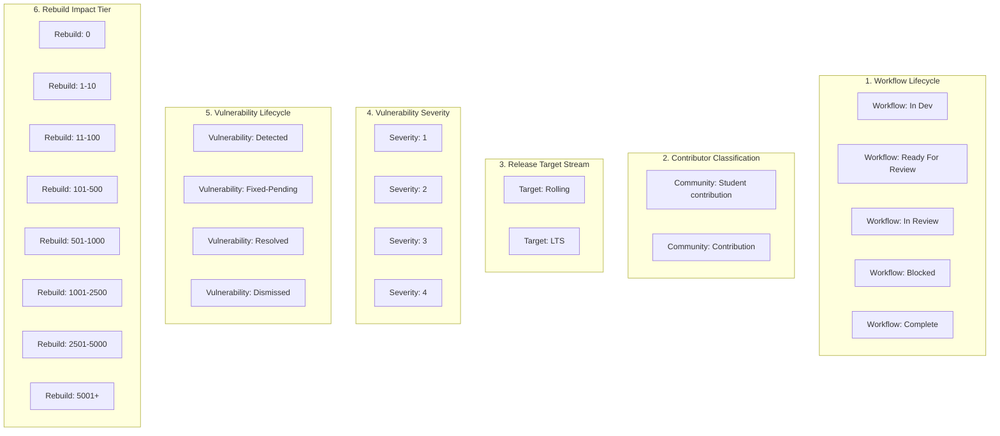

# Label Taxonomy and Governance Reference

This page is the authoritative reference for every label managed by `abaci-bot`. The source of truth in code is [`Services/GitHubLabels.cs`](../Services/GitHubLabels.cs).

> [!IMPORTANT]
> **Labels must exist in target repositories before deploying the bot.**
> GitHub's API does not automatically create missing labels when tagging issues or pull requests. Attempting to apply a non-existent label causes the request to fail, triggering a fail-fast pipeline abort for that event. Refer to [Creating Labels Upstream](#3-creating-labels-upstream).

---

## 1. Managed Label Taxonomy

The table below lists all labels defined in [`Services/GitHubLabels.cs`](../Services/GitHubLabels.cs):

| Label | Category / Origin | Purpose & Scope |
|---|---|---|
| `Workflow: In Dev` | Official Taxonomy | Work in progress (draft PR or title prefixed with `WIP`). |
| `Workflow: Ready For Review` | Official Taxonomy | Non-draft PR ready for peer maintainer review. |
| `Workflow: In Review` | Official Taxonomy | Active review by a team Captain or maintainer. |
| `Workflow: Blocked` | Official Taxonomy | Downstream rebuild impact threshold exceeded or review hold. |
| `Workflow: Complete` | Official Taxonomy | Pull request merged. |
| `Commits: Updated` | Official Taxonomy | New commits pushed while in `Workflow: Blocked`. Removed when a Captain responds. |
| `Status: New` | Official Taxonomy | Newly opened pull request awaiting initial human review. |
| `Status: Stale` | Official Taxonomy | Inactive issue or PR with no activity for `StaleDays`. |
| `Status: stale-exempt` | Official Taxonomy | Protects items from automated stale lifecycle sweeps. |
| `Status: ABI Unverified` | Bot Extension | Applied when ABI comparison cannot complete (missing artifact/baseline or tool failure). |
| `Target: Rolling` | Official Taxonomy | Pull request targets the rolling release stream (`main`, `master`, `rolling`). |
| `Target: LTS` | Official Taxonomy | Pull request targets a Long-Term Support release branch (`lts/*`, `lts-*`). |
| `Community: Student contribution` | Official Taxonomy | Contributor email ends with `.oerv@isrc.iscas.ac.cn`, `.or@isrc.iscas.ac.cn`, or `.riscv@isrc.iscas.ac.cn`. |
| `Community: Contribution` | Official Taxonomy | General community contribution from external domains. |
| `Type: Packaging` | Official Taxonomy | Modifies RPM spec files, patches, or package sources. |
| `Type: Documentation` | Official Taxonomy | Modifies documentation files exclusively. |
| `Type: Infrastructure` | Bot Extension | Modifies CI workflows, actions, or repository tooling without spec changes. |
| `Type: Frontend` | Bot Extension | Modifies web UI files. Active **only** on repositories listed in `ChangeTypeClassification:HomepageRepositories`. |
| `Type: Build Failure` | Reserved | Reserved constant in `GitHubLabels.cs` for future build error tracking. |
| `BuildSystem: autotools` | Official Taxonomy | Spec declares `BuildSystem: autotools`. |
| `BuildSystem: cmake` | Official Taxonomy | Spec declares `BuildSystem: cmake`. |
| `BuildSystem: golangmodule` | Official Taxonomy | Spec declares `BuildSystem: golangmodule`. |
| `BuildSystem: golang` | Official Taxonomy | Spec declares `BuildSystem: golang`. |
| `BuildSystem: rustcrate` | Official Taxonomy | Spec declares `BuildSystem: rustcrate`. |
| `BuildSystem: rust` | Official Taxonomy | Spec declares `BuildSystem: rust`. |
| `BuildSystem: meson` | Official Taxonomy | Spec declares `BuildSystem: meson`. |
| `BuildSystem: pyproject` | Official Taxonomy | Spec declares `BuildSystem: pyproject`. |
| `BuildSystem: misc` | Official Taxonomy | Fallback applied when a spec declares no recognized `BuildSystem:` header. |
| `CI` | Official Taxonomy | Pull request touches continuous integration workflows. |
| `AI Assistance` | Official Taxonomy | Author declared AI assistance in pull request description. |
| `Compliance: License Issue` | Bot Extension | Spec declares a missing or non-standard SPDX license identifier. |
| `Impact: ABI` | Official Taxonomy | Binary interface changes detected (applied to all ABI changes; accompanies `Impact: Breaking Change` on incompatible changes). |
| `Impact: Breaking Change` | Official Taxonomy | Binary interface breaking changes detected (e.g. SONAME change, removed or altered symbols). |
| `Severity: 1` | Official Taxonomy | Critical CVE severity (CVSS 9.0–10.0). |
| `Severity: 2` | Official Taxonomy | High CVE severity (CVSS 7.0–8.9). |
| `Severity: 3` | Official Taxonomy | Medium CVE severity (CVSS 4.0–6.9). |
| `Severity: 4` | Official Taxonomy | Low CVE severity (CVSS < 4.0, including 0.0). |
| `Vulnerability: Detected` | Official Taxonomy | CVE mentioned in an open or closed-without-merge PR; also applied on OSV/NVD query failures (fail-safe posture). |
| `Vulnerability: Fixed-Pending` | Official Taxonomy | CVE fix undergoing maintainer review (`Ready For Review` or `In Review`). |
| `Vulnerability: Resolved` | Official Taxonomy | PR addressing CVE merged into repository. Outranks query failures; only `Vulnerability: Dismissed` takes precedence. |
| `Vulnerability: Dismissed` | Official Taxonomy | CVE tracking dismissed by repository maintainers. |
| `Rebuild: 0` | Official Taxonomy | 0 downstream packages affected. |
| `Rebuild: 1-10` | Official Taxonomy | 1 to 10 downstream packages affected. |
| `Rebuild: 11-100` | Official Taxonomy | 11 to 100 downstream packages affected. |
| `Rebuild: 101-500` | Official Taxonomy | 101 to 500 downstream packages affected. |
| `Rebuild: 501-1000` | Official Taxonomy | 501 to 1000 downstream packages affected. |
| `Rebuild: 1001-2500` | Official Taxonomy | 1001 to 2500 downstream packages affected. |
| `Rebuild: 2501-5000` | Official Taxonomy | 2501 to 5000 downstream packages affected. |
| `Rebuild: 5001+` | Official Taxonomy | Over 5000 downstream packages affected. |
| `Auto-Update` | Bot Extension | Pull request automatically created for upstream package updates. |
| `Auto-Update: Rust` | Bot Extension | Pull request automatically created for Rust crate updates. |
| `Auto-Update: Blocked` | Bot Extension | Automated package updates blocked due to repeated failures or missing dependencies. |

---

## 2. Mutex Groups (Single-Choice Constraints)

`LabelMutexEngine` enforces mutual exclusivity across 6 distinct single-choice label groups. Scheduling any label in a group automatically schedules removals for all other labels in the same group:



---

## 3. Creating Labels Upstream

Run these commands using the GitHub CLI (`gh`) to provision all required labels in target repositories before deploying `abaci-bot`.

### 3.1 Primary Package Repository (`openRuyi-Project/openRuyi`)

```bash
REPO="openRuyi-Project/openRuyi"

# 1. Workflow Lifecycle
gh label create "Workflow: In Dev" --repo "$REPO" --color "fbca04" --description "Work in progress or draft pull request." --force
gh label create "Workflow: Ready For Review" --repo "$REPO" --color "0e8a16" --description "Pull request is ready for maintainer review." --force
gh label create "Workflow: In Review" --repo "$REPO" --color "1d76db" --description "Pull request is actively under review by maintainers." --force
gh label create "Workflow: Blocked" --repo "$REPO" --color "b60205" --description "Pull request is blocked due to excessive rebuild impact or review hold." --force
gh label create "Workflow: Complete" --repo "$REPO" --color "6f42c1" --description "Pull request has been merged." --force

# 2. Status & Triage
gh label create "Status: New" --repo "$REPO" --color "c5def5" --description "Newly opened pull request awaiting initial human review." --force
gh label create "Status: Stale" --repo "$REPO" --color "ffffff" --description "Inactive issue or pull request subject to automated closure." --force
gh label create "Status: stale-exempt" --repo "$REPO" --color "ffffff" --description "Protected from automated stale lifecycle sweeps." --force
gh label create "Status: ABI Unverified" --repo "$REPO" --color "ededed" --description "ABI comparison could not be completed (tool or baseline unavailable)." --force

# 3. Release Target Streams
gh label create "Target: Rolling" --repo "$REPO" --color "bfdadc" --description "Targets the rolling release branch." --force
gh label create "Target: LTS" --repo "$REPO" --color "d4c5f9" --description "Targets a Long-Term Support release branch." --force

# 4. Contributor Classification
gh label create "Community: Student contribution" --repo "$REPO" --color "006b75" --description "Contribution from verified student email domains." --force
gh label create "Community: Contribution" --repo "$REPO" --color "bfd4f2" --description "General community contribution." --force

# 5. Change Types & Bot Extensions
gh label create "Type: Packaging" --repo "$REPO" --color "c2e0c6" --description "Modifies RPM packaging, specs, or patches." --force
gh label create "Type: Documentation" --repo "$REPO" --color "0075ca" --description "Modifies documentation files exclusively." --force
gh label create "Type: Infrastructure" --repo "$REPO" --color "ed9121" --description "Modifies repository workflows or infrastructure." --force

# 6. Build Systems & CI
gh label create "CI" --repo "$REPO" --color "5319e7" --description "Modifies continuous integration configuration." --force
gh label create "BuildSystem: autotools" --repo "$REPO" --color "d4c5f9" --description "Spec builds using GNU Autotools." --force
gh label create "BuildSystem: cmake" --repo "$REPO" --color "d4c5f9" --description "Spec builds using CMake." --force
gh label create "BuildSystem: golangmodule" --repo "$REPO" --color "d4c5f9" --description "Spec builds using Go modules." --force
gh label create "BuildSystem: golang" --repo "$REPO" --color "d4c5f9" --description "Spec builds using standard Go." --force
gh label create "BuildSystem: rustcrate" --repo "$REPO" --color "d4c5f9" --description "Spec builds using Rust Cargo crates." --force
gh label create "BuildSystem: rust" --repo "$REPO" --color "d4c5f9" --description "Spec builds using Rust toolchain." --force
gh label create "BuildSystem: meson" --repo "$REPO" --color "d4c5f9" --description "Spec builds using Meson." --force
gh label create "BuildSystem: pyproject" --repo "$REPO" --color "d4c5f9" --description "Spec builds using Python pyproject." --force
gh label create "BuildSystem: misc" --repo "$REPO" --color "d4c5f9" --description "Fallback applied when spec declares no recognized BuildSystem header." --force

# 7. Compliance & Notifications
gh label create "Compliance: License Issue" --repo "$REPO" --color "6699cc" --description "Spec declares a missing or non-standard SPDX license identifier." --force
gh label create "Commits: Updated" --repo "$REPO" --color "d93f0b" --description "New commits pushed while pull request was in Workflow: Blocked." --force
gh label create "AI Assistance" --repo "$REPO" --color "0052cc" --description "Author declared AI assistance in the pull request description." --force

# 8. ABI and Breaking Changes
gh label create "Impact: ABI" --repo "$REPO" --color "ff7619" --description "Binary interface changes detected (applied on both compatible and incompatible changes)." --force
gh label create "Impact: Breaking Change" --repo "$REPO" --color "d93f0b" --description "Binary interface breaking change detected (e.g. SONAME change, removed symbols)." --force

# 9. CVE Severity & Lifecycle
gh label create "Severity: 1" --repo "$REPO" --color "ff0000" --description "Critical CVE severity (CVSS 9.0-10.0)." --force
gh label create "Severity: 2" --repo "$REPO" --color "ff6600" --description "High CVE severity (CVSS 7.0-8.9)." --force
gh label create "Severity: 3" --repo "$REPO" --color "ffcc00" --description "Medium CVE severity (CVSS 4.0-6.9)." --force
gh label create "Severity: 4" --repo "$REPO" --color "cccccc" --description "Low CVE severity (CVSS < 4.0, including 0.0)." --force
gh label create "Vulnerability: Detected" --repo "$REPO" --color "b60205" --description "CVE mentioned; security verification active or upstream unverified." --force
gh label create "Vulnerability: Fixed-Pending" --repo "$REPO" --color "fbca04" --description "CVE fix undergoing maintainer review." --force
gh label create "Vulnerability: Resolved" --repo "$REPO" --color "0e8a16" --description "CVE fix merged into repository." --force
gh label create "Vulnerability: Dismissed" --repo "$REPO" --color "e4e669" --description "CVE tracking dismissed by repository maintainers." --force

# 10. Rebuild Impact Tiers
gh label create "Rebuild: 0" --repo "$REPO" --color "c2e0c6" --description "No downstream package rebuilds required." --force
gh label create "Rebuild: 1-10" --repo "$REPO" --color "c2e0c6" --description "1 to 10 downstream packages affected." --force
gh label create "Rebuild: 11-100" --repo "$REPO" --color "bfdadc" --description "11 to 100 downstream packages affected." --force
gh label create "Rebuild: 101-500" --repo "$REPO" --color "fef2c0" --description "101 to 500 downstream packages affected." --force
gh label create "Rebuild: 501-1000" --repo "$REPO" --color "fef2c0" --description "501 to 1000 downstream packages affected." --force
gh label create "Rebuild: 1001-2500" --repo "$REPO" --color "d4c5f9" --description "1001 to 2500 downstream packages affected." --force
gh label create "Rebuild: 2501-5000" --repo "$REPO" --color "f9d0c4" --description "2501 to 5000 downstream packages affected." --force
gh label create "Rebuild: 5001+" --repo "$REPO" --color "e99695" --description "Over 5000 downstream packages affected." --force

# 11. Automated Package Updates
gh label create "Auto-Update" --repo "$REPO" --color "0366d6" --description "Pull request automatically created for package updates." --force
gh label create "Auto-Update: Rust" --repo "$REPO" --color "dea584" --description "Pull request automatically created for Rust crate updates." --force
gh label create "Auto-Update: Blocked" --repo "$REPO" --color "d73a4a" --description "Package updates blocked due to repeated failures or missing dependencies." --force
```

### 3.2 Homepage Repository (`openRuyi-Project/homepage`)

Frontend asset classification applies only to the `homepage` repository:

```bash
REPO="openRuyi-Project/homepage"
gh label create "Type: Frontend" --repo "$REPO" --color "e99695" --description "Modifies frontend assets (.vue, .ts, .css, etc.)." --force
```

> [!NOTE]
> The `homepage` repository is not an active bot deployment target today. If the bot is deployed to `homepage` in the future, the complete baseline label set from §3.1 must also be provisioned there to prevent fail-fast aborts on pull request triage.

---

## 4. Sandbox Migration Guide

When upgrading existing repositories or sandboxes to the current release:

1. **Retire `new`**:
   - Create `Status: New`.
   - Re-tag active PRs carrying `new` with `Status: New`.
   - Delete label `new`.

2. **Retire `Status: Pinned`**:
   - Create `Status: stale-exempt`.
   - Re-tag active items carrying `Status: Pinned` with `Status: stale-exempt`.
   - Delete label `Status: Pinned`.

3. **Retire `Impact: ABI Check Failed`**:
   - Create `Status: ABI Unverified`.
   - Re-tag active PRs carrying `Impact: ABI Check Failed` with `Status: ABI Unverified`.
   - Delete label `Impact: ABI Check Failed`.

4. **Retire `Vulnerability: Pending Verification`**:
   - Re-tag any existing PRs carrying `Vulnerability: Pending Verification` with `Vulnerability: Detected`.
   - Delete label `Vulnerability: Pending Verification`.

---

## 5. Specification Alignment Notes

- **Fail-Safe CVE Handling (D1)**: In previous design drafts, query failures (OSV/NVD unreachable) suggested applying `Vulnerability: Pending Verification`. To maintain strict fail-safe security posture, query failures instead apply `Vulnerability: Detected`, ensuring that potential vulnerabilities are never downgraded or overlooked due to network anomalies.
- **Repository-Scoped Extensions (D2)**: `Type: Frontend` is restricted exclusively to the `homepage` repository, while package repositories (`openRuyi`) evaluate `Type: Packaging`, `Type: Documentation`, and `Type: Infrastructure`.
- **Title Case Convention (D3)**: Labels maintain Title Case prefixes (`Status:`, `Workflow:`, `Target:`) for operational readability.
- **Rebuild Tier Granularity (D4)**: Rebuild tiers begin from `Rebuild: 1-10` above 0 per design specifications.
