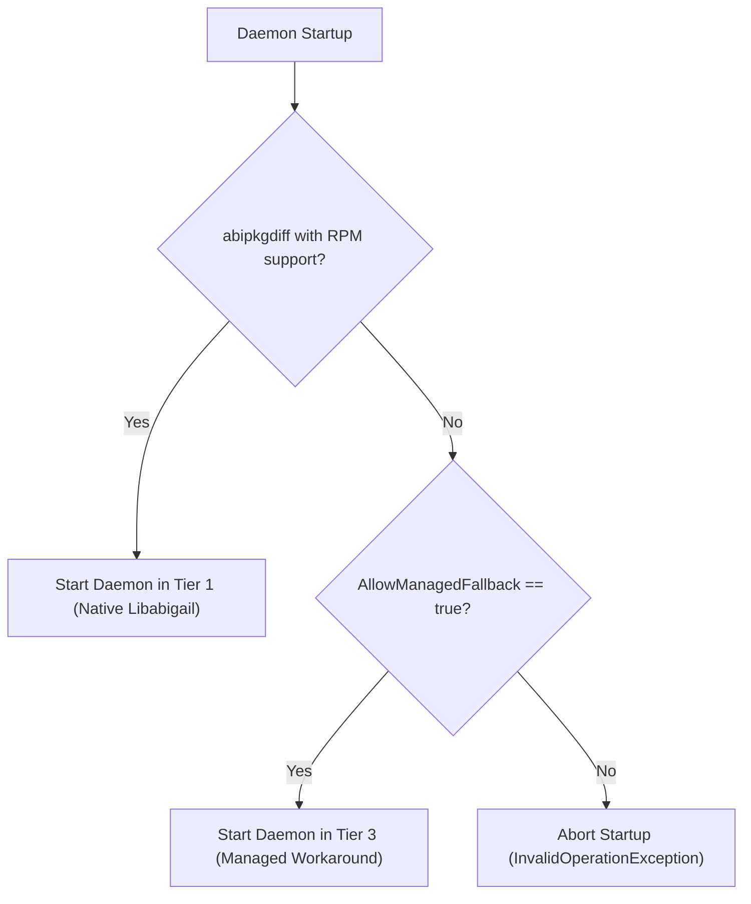
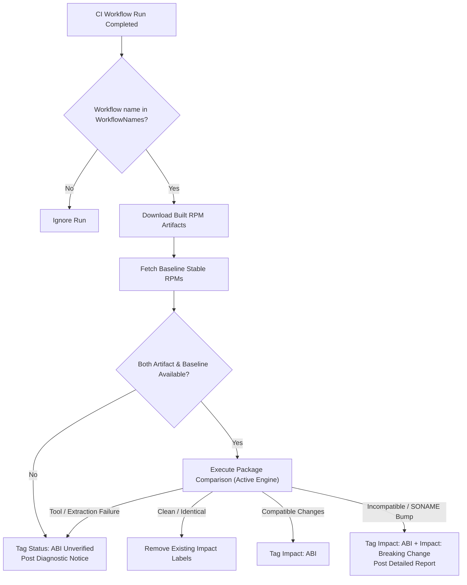

# Binary ABI Compliance Module

Compares compiled RPM packages against baseline stable builds using Libabigail (`abipkgdiff`) to detect binary shared library incompatibilities and breaking changes.

---

## 1. Purpose and Trigger Events

Prevents binary application interface (ABI) breakages from breaking downstream packages at runtime. Runs upon completion of CI build workflows.

### Trigger Events
- `workflow_run` (`completed`)

---

## 2. Evaluation Logic and Two-Phase Architecture

The ABI subsystem operates in two distinct phases:

### Phase A: Startup Deployment Gate (`AbiEngineProbe`)
Before serving webhooks, `AbiEngineProbe` runs as a hosted startup service:
- Runs `abipkgdiff --version` and a dry-run against embedded v4/v6 fixture RPMs. RPM support and v6 capability are inferred from exit codes and stderr; `rpm2cpio` and `cpio` are not probed directly.
- **Native Available**: Starts daemon in Tier 1 (Native Libabigail).
- **Native Missing**:
  - If `AllowManagedFallback == true`: logs warning and starts daemon with Tier 3 managed fallback workaround.
  - If `AllowManagedFallback == false`: **aborts startup immediately** with `InvalidOperationException` directing operators to documentation.



### Phase B: Per-Workflow-Run Comparison (`AbiComplianceModule`)
When a CI build finishes, `AbiComplianceModule` executes the package diff:



---

## 3. Managed Labels and Mutex Rules

### Impact Labels
- `Impact: ABI`: Binary interface changes detected (applied to all ABI changes, accompanying `Impact: Breaking Change` on incompatible changes).
- `Impact: Breaking Change`: Incompatible binary changes detected (e.g. SONAME changed, exported functions removed or altered).
- `Status: ABI Unverified`: Comparison could not be completed (RPM artifact missing, baseline unavailable, or tool extraction failure). Replaces legacy `Impact: ABI Check Failed`.

---

## 4. Configuration Options

Configured under the `AbiCompliance` JSON section:

| Parameter | Type | Default | Description |
|---|---|---|---|
| `Enabled` | `bool` | `true` | Master toggle for binary ABI compliance checking. |
| `AbipkgdiffExecutablePath` | `string` | `"abipkgdiff"` | Binary path or command name for Libabigail `abipkgdiff`. |
| `EnableFallback` | `bool` | `true` | Controls whether the service falls back to the managed C# ELF engine when native tools are missing or when analyzing an RPM v6 package without native v6 support. |
| `AllowManagedFallback` | `bool` | `false` | Workaround consent gate. Allows falling back to pure managed C# ELF analysis when Libabigail is absent. Production deployments should leave this `false` and run in Fedora 45 containers. |
| `StrictEngine` | `bool` | `false` | When `true`, native tool absence immediately causes startup failure, overriding `AllowManagedFallback` and environment/file overrides. |
| `WorkflowNames` | `string[]` | `["build", "package", "rpm"]` | Workflow name/path substrings monitored for completion. Empty uses the built-in `build`/`package`/`rpm` list. |
| `StableRpmBaseUrl` | `string?` | `null` | Base URL used to download baseline/stable RPMs for comparison. When unset, baseline is unavailable and PR is tagged `Status: ABI Unverified`. |
| `TempExtractionDirectory` | `string?` | `null` | Path for temporary extraction buffers (null uses system temporary path). |
| `TimeoutSeconds` | `int` | `300` | Process execution timeout in seconds. |
| `MaxTotalPayloadBytes` | `long` | `1073741824` | Maximum uncompressed total payload bytes processed by managed ELF/RPM engine (1 GB). |

---

## 5. ABI Engine Tiers and Operational Guidelines

| Tier | Engine | Capabilities | Supported Environment |
|---|---|---|---|
| **Tier 1 (Native)** | Libabigail `abipkgdiff` with `rpm` (`rpm2cpio`), `cpio`, `libicu` | Full DWARF type layout comparison, struct padding, enum sizes, symbol versioning, SONAME checks. | Fedora 45+ OCI container or host with native Libabigail and RPM v4/v6 tools. |
| **Tier 3 (Managed Workaround)** | Pure C# ELF header parser | Symbol-level export/import table comparison and SONAME checking. **No DWARF type validation**. | Pure managed environments where `AllowManagedFallback = true` is explicitly configured. |

---

## 6. Minimal Configuration Example

```json
{
  "AbiCompliance": {
    "Enabled": true,
    "AbipkgdiffExecutablePath": "abipkgdiff",
    "AllowManagedFallback": false,
    "WorkflowNames": [ "build", "package", "rpm" ],
    "StableRpmBaseUrl": "https://repo.openruyi.cn/raw/rolling/"
  }
}
```

---

## 7. Relevant Test Suites

- `tests/abaci-bot.Tests/AbiComplianceModuleTests.cs`
- `tests/abaci-bot.Tests/AbiDiffServiceTests.cs`
- `tests/abaci-bot.Tests/GitHubWebhookProcessorTests.cs`

