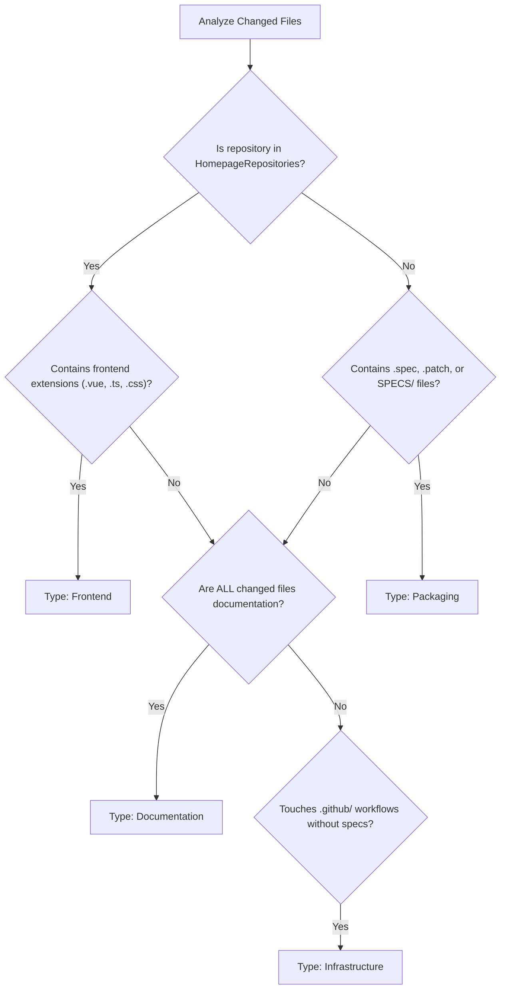

# Change Type Classification Module

Classifies pull requests into functional categories based on changed file extensions and directory paths.

---

## 1. Purpose and Trigger Events

Helps maintainers quickly distinguish packaging updates from documentation improvements, infrastructure edits, or frontend changes.

### Trigger Events
- `pull_request` (`opened`, `synchronize`, `reopened`, `ready_for_review`, `converted_to_draft`)

---

## 2. Evaluation Logic and Workflow



---

## 3. Managed Labels and Mutex Group

### Change Type Labels
- `Type: Packaging`: Modifies RPM spec files, patches, or package source directories.
- `Type: Documentation`: Modifies markdown, text, or documentation directories exclusively.
- `Type: Infrastructure`: Modifies CI workflows, actions, or tooling without spec changes.
- `Type: Frontend`: Modifies web UI files. Active **only** on repositories designated in `HomepageRepositories`.

---

## 4. Configuration Options

Configured under the `ChangeTypeClassification` JSON section:

| Parameter | Type | Default | Description |
|---|---|---|---|
| `DocumentationExtensions` | `string[]` | `[".md", ".txt", ".rst"]` | File extensions recognized as documentation. |
| `DocumentationDirectories` | `string[]` | `["docs/", "doc/"]` | Directory paths recognized as documentation. |
| `PackagingExtensions` | `string[]` | `[".spec", ".patch", ".diff"]` | File extensions indicating RPM packaging changes. |
| `PackagingDirectories` | `string[]` | `["SPECS/", "SOURCES/"]` | Directory paths indicating RPM packaging changes. |
| `FrontendExtensions` | `string[]` | `[".vue", ".ts", ".js", ...]` | File extensions indicating frontend assets. |
| `PackageRepositories` | `string[]` | `["openRuyi"]` | Repositories subject to standard RPM packaging classification. |
| `HomepageRepositories` | `string[]` | `["homepage"]` | Repositories where frontend rules apply instead of packaging rules. |

---

## 5. Failure Handling and Fallback Semantics

- **Mixed Diffs**: If a PR contains both spec files and documentation files, `Type: Packaging` takes precedence. `Type: Documentation` is applied only when **all** changed files are documentation.
- **Repository Isolation**: `Type: Frontend` is never applied to the main package repository (`openRuyi`).
- **Zero-File Diff**: When the branch tree becomes identical to the base, no change type applies and every managed `Type:` label is removed. An empty file list is authoritative because the GitHub file listing raises on API failure instead of returning empty.
- **Reclassification**: The module reconciles the full managed set, so a diff that moves from packaging to documentation removes `Type: Packaging` in the same run instead of leaving both labels. `LabelMutexEngine` does not arbitrate this group, so the module is responsible for the exclusivity.

---

## 6. Minimal Configuration Example

```json
{
  "ChangeTypeClassification": {
    "PackageRepositories": [ "openRuyi" ],
    "HomepageRepositories": [ "homepage" ]
  }
}
```

---

## 7. Relevant Test Suites

- `tests/abaci-bot.Tests/ChangeTypeClassificationModuleTests.cs`
