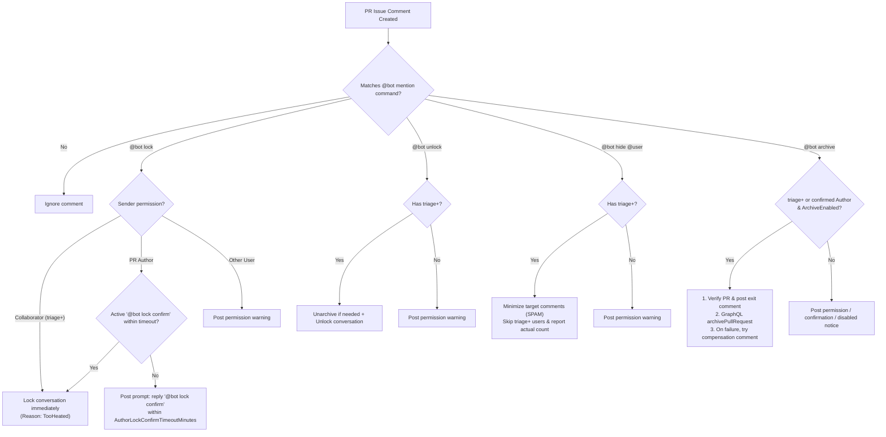

# Conversation Guard & Moderation Module

Provides pull request conversation locking, comment spam suppression, PR archiving commands, and automated locking of inactive closed pull requests.

---

## 1. Purpose and Trigger Events

High-profile or contentious package changes can attract heated discussions, post-closure harassment, or spam comments. `ConversationGuardModule` (Priority: 95) empowers PR authors and maintainers to control discussion state using slash commands. In addition, `LockSweepService` scans closed pull requests and automatically locks discussions after an extended period of inactivity.

### Trigger Events
- `issue_comment` (`created`) on **Pull Requests only** (plain repository issues are ignored by the webhook processor)
- Periodic background timer (`LockSweepService`, default every 12 hours)

---

## 2. Slash Commands, Authorization, and Moderation Workflow

When `ConversationGuard:Enabled` is `true`, maintainer authority is verified against **GitHub's authoritative repository collaborator permissions** (`triage`, `write`, `maintain`, or `admin` via `IRepositoryPermissionService`). This accurately handles first-time contributors, external collaborators without organization membership, and read-only organization members.

> [!IMPORTANT]
> Enabling `ConversationGuard` requires granting the GitHub App **Administration: Read-only** (or **Contents: Read & write**) so `ConversationGuardPermissionProbe` and command authorization can query repository collaborator permissions for `@<bot> lock`, `@<bot> unlock`, and `@<bot> hide`.
> Enabling `ConversationGuard:ArchiveEnabled` (`@<bot> archive`) additionally requires **Administration: Read & write** on the GitHub App (or a `triage`+ `PackageUpdate:BotPat`), because standard minimal App tokens receive `FORBIDDEN` on GitHub's `archivePullRequest` mutation. When `ArchiveEnabled == true`, startup aborts if archive permission is missing. Leave `ConversationGuard:Enabled` set to `false` to stay on the baseline minimal permissions in [deployment.md](../deployment.md).



### Supported Mention Commands

All commands address the bot using its live GitHub handle (resolved automatically from GitHub API via `BotPat` or GitHub App slug, e.g., `@abaci-bot`).

| Command | Allowed Callers | Confirmation / Behavior |
|---|---|---|
| `@<bot> lock` | Collaborators (`triage`+), PR Author | Collaborators (`triage`+) lock immediately. Non-privileged PR authors receive a prompt requiring `@<bot> lock confirm` (or `@<bot> lock yes`) within `AuthorLockConfirmTimeoutMinutes`. Checks `IsIssueLockedAsync` first, posts the lock announcement **before** locking (since locked issues reject App comments with 403), and locks with reason `TooHeated`. |
| `@<bot> lock confirm` | PR Author, Collaborators (`triage`+) | Atomically completes author self-lock if an active request exists within the TTL window; otherwise starts a new confirmation window. |
| `@<bot> unlock` | Collaborators (`triage`+) only | Checks `IsIssueLockedAsync` first; when locked, unarchives if previously archived, unlocks the conversation, and posts the unlock notice. If not currently locked, replies without posting a false unlock confirmation. |
| `@<bot> hide @username` | Collaborators (`triage`+) only | Supports standard logins and `[bot]` slugs (`@app[bot]`). Folds all comments by `@username` using GitHub GraphQL `minimizeComment(classifier: SPAM)`. Never deletes comments. Comments authored by users with `triage`+ repository access are protected; distinguishes "no comments found", all-failed, partial-failed (`X of Y`), and all-succeeded counts. |
| `@<bot> archive` | Collaborators (`triage`+), PR Author | Archives the pull request via GraphQL `archivePullRequest`. Requires `ArchiveEnabled == true` **and** GitHub App `Administration: Read & write` (or a `triage`+ `BotPat`); non-privileged PR authors must confirm via `@<bot> archive confirm` within `AuthorLockConfirmTimeoutMinutes`. Always posts an exit comment before archiving, and posts an actionable compensation comment if GraphQL fails or returns `FORBIDDEN`. |

---

## 3. Inactive Pull Request Locking

`LockSweepService` runs periodically (default every 12 hours) to lock abandoned closed pull requests:
- Evaluates `closed_at` timestamps using paginated GitHub search (`is:pr is:closed is:unlocked closed:<{date}`, up to 500 items per sweep).
- PRs closed longer than `InactiveCloseDays` (default: 60 days) are locked with reason `TooHeated`.
- When search results exceed the 5-page limit, truncation is surfaced explicitly via a warning log and remaining items defer to subsequent sweeps.

---

## 4. Configuration Options

Configured under the `ConversationGuard` JSON section:

| Parameter | Type | Default | Range / Allowed | Description |
|---|---|---|---|---|
| `Enabled` | `bool` | `false` | `true`, `false` | Master switch for conversation guard commands, startup permission probe, and lock sweep service. |
| `DryRun` | `bool` | `true` | `true`, `false` | When true, performs **zero GitHub writes** (logs moderation actions and suppresses rejection, usage, and confirmation prompt comments). |
| `RepositoryAllowList` | `string[]` | `[]` | Strict `owner/repo` list | Repositories permitted to execute conversation guard actions (bare repository names fail startup validation). Empty disables moderation globally. |
| `ArchiveEnabled` | `bool` | `false` | `true`, `false` | Dedicated safety switch for PR-level archiving (`@<bot> archive`). When `false`, archive commands are rejected; when `true`, `ConversationGuardPermissionProbe` also requires GitHub App `Administration: Read & write` (or a `triage`+ `BotPat`) at startup and aborts startup if missing. |
| `InactiveCloseDays` | `int` | `60` | `7..365` | Inactivity threshold in days based on `closed_at` before closed PRs are locked. |
| `SweepIntervalHours` | `int` | `12` | `1..72` | Execution interval in hours for the background inactive PR lock sweep service. |
| `AuthorLockConfirmTimeoutMinutes` | `int` | `15` | `1..60` | Time window in minutes for the PR author to reply with `@<bot> lock confirm` (or `@<bot> archive confirm`) before the confirmation request expires. |

---

## 5. Failure Handling and Fallback Semantics

- **Fail-Fast Permission Probe & Fail-Closed Authorization**: Whenever `ConversationGuard:Enabled == true` (including `DryRun == true`), `ConversationGuardPermissionProbe` verifies collaborator endpoint access at startup on every repository in `RepositoryAllowList` (and verifies `Administration: Read & write` or a `triage`+ `BotPat` when `ArchiveEnabled == true`), aborting startup if required permissions are missing — ensuring dry-run authorization logs and archive readiness accurately reflect production credentials. At runtime, permission lookup errors fail closed (denying privileged commands).
- **Strict Zero-Write DryRun**: When `DryRun == true`, `ConversationGuardService` suppresses all GitHub write operations, including unauthorized warning replies, `hide` usage/protection notices, `archive` disabled notices, and PR author confirmation prompt comments.
- **Pending Confirmation State Lifecycle**: Author confirmation tokens are held in-memory inside `PendingConfirmationStore` (bounded to 4096 entries with lazy expiration pruning). Expired tokens are pruned automatically and cannot be replayed; pending unconfirmed requests do not survive process restarts, requiring the author to re-initiate `@<bot> lock` or `@<bot> archive`.
- **Archiving Ordering & Compensation Guard**: Because archived PRs reject comments with HTTP 403, the service resolves the PR first, posts the exit explanation comment **before** calling `archivePullRequest`, and wraps any failure compensation comment in its own exception guard so concurrent archiving (403) does not bubble up to the pipeline.
- **Cross-Module 403 Isolation**: Background sweep workers (`MilestoneBackfillSweepService`, `LockSweepService`, `ObsPostMergeVerifier`) catch per-item exceptions including HTTP 403 on archived PRs, while `StaleLifecycleService` scans only open items (`is:open`).
- **No Comment Deletions**: `@<bot> hide` exclusively folds comments via `SPAM` minimization; comments are never deleted.

---

## 6. Minimal Configuration Example

```json
{
  "ConversationGuard": {
    "Enabled": true,
    "DryRun": false,
    "RepositoryAllowList": [
      "5teve2NT/openRuyi"
    ],
    "ArchiveEnabled": false,
    "InactiveCloseDays": 60,
    "SweepIntervalHours": 12,
    "AuthorLockConfirmTimeoutMinutes": 15
  }
}
```

---

## 7. Relevant Test Suites

- `tests/abaci-bot.Tests/ConversationGuardOptionsValidatorTests.cs`
- `tests/abaci-bot.Tests/ConversationGuardPermissionProbeTests.cs`
- `tests/abaci-bot.Tests/PendingConfirmationStoreTests.cs`
- `tests/abaci-bot.Tests/ConversationGuardServiceTests.cs`
- `tests/abaci-bot.Tests/ConversationGuardModuleTests.cs`
- `tests/abaci-bot.Tests/LockSweepServiceTests.cs`
- `tests/abaci-bot.Tests/RepositoryAllowListTests.cs`
