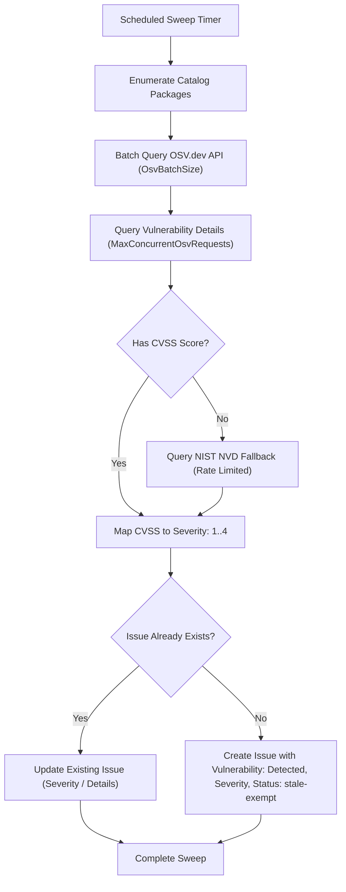

# Active CVE Vulnerability Watch Service

Autonomous background worker that periodically scans distribution package specifications against OSV.dev and NIST NVD CVE 2.0 to file and reconcile security tracking issues.

---

## 1. Purpose and Trigger Events

Provides repository-wide proactive vulnerability monitoring across all package specifications in the distribution catalog. Operates as an independent scheduled background service (`IHostedService`).

### Trigger Mechanism
- Periodic background timer configured by `CheckIntervalHours` (default: every 24 hours).
- Does not rely on incoming webhook events.

---

## 2. Evaluation Logic and Workflow



### Key Functional Behaviors
1. **O(1) Tarball Catalog & Slice-Before-Fetch Fallback**: `GitHubSpecCatalog` loads all `SPECS/*/*.spec` definitions in a single GitHub tarball snapshot (`GetArchive`, cached for 6 hours). If archive download is unavailable and the catalog falls back to Git Trees + per-file fetches, `CveActiveWatchService` slices `PackagesPerSweep` sorted package names **before** fetching `.spec` contents so a sweep never triggers O(N) GitHub API requests.
2. **OSV Batch Ingestion**: Queries OSV.dev batch API using chunks up to `OsvBatchSize` (default: 1000) for high-throughput package scanning.
3. **NVD Fallback Throttling**: When OSV records lack CVSS score metrics, falls back to NIST NVD CVE 2.0 API subject to daily quota (`MaxNvdQueriesPerDay`) and serialized delay (`NvdRequestDelayMilliseconds` = 6500 ms) to avoid HTTP 429 rate limits.
4. **Issue Lifecycle Management**: Automatically files GitHub tracking issues containing CVE identifiers, CVSS scores, and package names. Existing open issues are updated idempotently, reconciling severity labels (removing obsolete `Severity:*` labels) and resolving issues once fixed.
5. **Protection**: Applies `Status: stale-exempt` to prevent `StaleLifecycleService` from auto-closing unresolved security tracking issues.

---

## 3. Managed Labels and Mutex Group

- `Vulnerability: Detected`: Base label applied to active CVE tracking issues.
- `Severity: 1`, `Severity: 2`, `Severity: 3`, `Severity: 4`: CVSS severity tier assigned based on the highest CVSS v3.1/v4.0 score. When no valid score is available from OSV or NVD, no severity label is attached.
- `Status: stale-exempt`: Applied to tracking issues to protect them from automated stale sweeps.

---

## 4. Configuration Options

Configured under the `CveActiveWatch` JSON section in `appsettings.json`:

| Parameter | Type | Default | Description |
|---|---|---|---|
| `Enabled` | `bool` | `false` | Master toggle for the proactive CVE watch service. |
| `DryRun` | `bool` | `true` | When `true`, scans packages and logs findings without creating or updating issues. |
| `TargetRepository` | `string` | `"openRuyi-Project/openRuyi"` | Repository to scan and track security issues in. |
| `CheckIntervalHours` | `int` | `24` | Interval in hours between full catalog vulnerability sweeps. |
| `OsvBatchSize` | `int` | `1000` | Package batch size per OSV query chunk (API max: 1000). |
| `PackagesPerSweep` | `int` | `0` | Packages to scan per sweep. When 0, scans the full catalog. When non-zero, sweeps advance sequentially through the package catalog across successive cycles. |
| `MaxNvdQueriesPerDay` | `int` | `200` | Daily request cap for NIST NVD fallback queries. |
| `NvdRequestDelayMilliseconds` | `int` | `6500` | Serialized inter-request throttle delay for unauthenticated NVD queries. |
| `MaxConcurrentOsvRequests` | `int` | `8` | Maximum concurrent HTTP requests dispatched when resolving OSV vulnerability details. |
| `IssueLabel` | `string` | `"Vulnerability: Detected"` | Primary label applied to security tracking issues. |
| `CacheExpirationHours` | `int` | `168` | Cache duration in hours for package vulnerability lookup results. |

---

## 5. Failure Handling and Fallback Semantics

- **Source Resilience**: OSV query failures are logged and do not crash the sweep. NVD queries back off and fail gracefully if HTTP 429 or network timeouts occur.
- **Fail-Safe Issue Tracking**: If CVE severity cannot be determined from either OSV or NVD, issues are created with base tracking label `Vulnerability: Detected` without crashing.

---

## 6. Minimal Configuration Example

```json
{
  "CveActiveWatch": {
    "Enabled": true,
    "DryRun": false,
    "TargetRepository": "openRuyi-Project/openRuyi",
    "CheckIntervalHours": 24
  }
}
```
