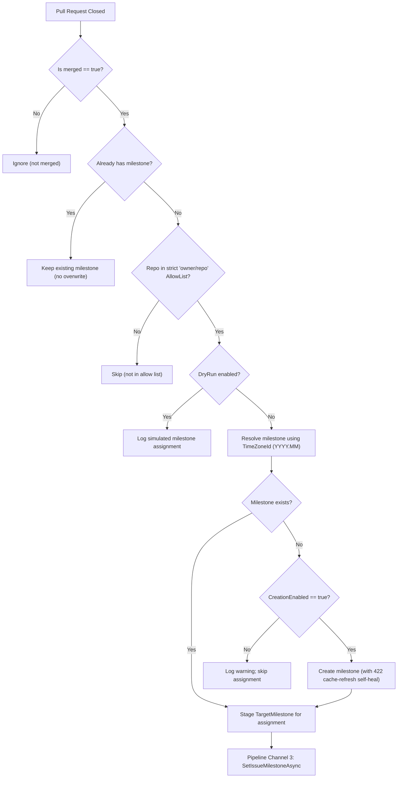

# Milestone Synchronization Module

Automates the assignment of merged pull requests to monthly release milestones (`YYYY.MM`) and provisions missing milestones.

---

## 1. Purpose and Trigger Events

Packages merged into rolling or LTS development branches belong to monthly release cycles. `MilestoneSyncModule` (Priority: 90) automatically maps merged pull requests to release milestones matching their merge timestamp under the configured IANA or system timezone `TimeZoneId` (default: `"Asia/Shanghai"`; format: `YYYY.MM`, e.g. `2026.11`). A background worker (`MilestoneBackfillSweepService`) periodically sweeps historical merged pull requests to backfill any unassigned items.

### Trigger Events
- `pull_request` (`closed`) — evaluated only when the pull request is merged
- Periodic background timer (`MilestoneBackfillSweepService`, default every 24 hours)

---

## 2. Evaluation Logic and Workflow



### Channel 3 Isolation
Milestone synchronization runs in pipeline **Channel 3**, strictly decoupled from label synchronization (Channel 1) and comment posting (Channel 2). If a network timeout, permission error, or milestone API validation failure occurs during milestone assignment, the pipeline logs a warning but never rolls back or fails the already committed label changes.

---

## 3. Managed Attributes

This module does not manage pull request labels; it directly manages GitHub Milestones.
- Matches format: `^\d{4}\.\d{2}$` (e.g. `2026.11`).
- Ignores special or long-term buckets such as `Future` or `Backlog`.
- Serializes creation per repository using an in-memory lock (`SemaphoreSlim`) and self-heals cached entries upon HTTP 422 duplicate milestone conflicts.

---

## 4. Configuration Options

Configured under the `MilestoneSync` JSON section:

| Parameter | Type | Default | Range / Allowed | Description |
|---|---|---|---|---|
| `Enabled` | `bool` | `false` | `true`, `false` | Master switch for milestone automation and backfill sweep. |
| `DryRun` | `bool` | `true` | `true`, `false` | When true, logs intended milestone operations without modifying GitHub. |
| `RepositoryAllowList` | `string[]` | `[]` | Strict `owner/repo` list | Repositories permitted to undergo milestone assignment and creation (bare names fail startup validation). Empty disables milestone operations globally. |
| `CreationEnabled` | `bool` | `false` | `true`, `false` | Whether the bot may create missing monthly milestones on GitHub. |
| `DueDayOfMonth` | `int` | `25` | `1..28` | Default due day of month assigned when creating a new milestone. |
| `BackfillDays` | `int` | `30` | `1..365` | Lookback window in days for the background backfill sweep service. |
| `SweepIntervalHours` | `int` | `24` | `1..168` | Interval in hours between background backfill sweep runs. |
| `TimeZoneId` | `string` | `"Asia/Shanghai"` | Valid IANA/system TZ ID | Timezone identifier applied to merge and close timestamps when determining `YYYY.MM` (handles UTC offsets and DST transitions; default targets `openRuyi` deployment convention, override to `"UTC"` or any IANA ID for other distributions; empty or invalid IDs fail startup validation). |

---

## 5. Failure Handling and Fallback Semantics

- **Preserve Existing Milestones**: Pull requests that already carry a milestone (whether manually set or pre-assigned) are never overwritten.
- **Fail-Safe Channel 3**: Milestone mutation failure never triggers pipeline compensation rollback on labels or aborts comment delivery.
- **422 Self-Healing & Timezone Calibration**: If a maintainer manually creates a monthly milestone before the 5-minute cache expires and `CreateMilestoneAsync` hits HTTP 422, `MilestoneResolver` automatically refreshes remote milestones and returns the matching number. Month attribution applies `TimeZoneInfo.ConvertTime` using `TimeZoneId` (supporting UTC offsets and DST; note that `.NET` `DateTimeOffset` and GitHub timestamps do not represent leap seconds). Code defaults to `"Asia/Shanghai"` following `openRuyi`'s deployment policy (other distributions override `TimeZoneId` in `appsettings.json`, e.g. `"UTC"`). Missing or unrecognized `TimeZoneId` values fail fast on startup via `MilestoneSyncOptionsValidator` rather than silently falling back to UTC, preventing silent misattribution across month boundaries. Created due dates are normalized to 23:59:59 UTC on `DueDayOfMonth`.
- **Search Pagination Awareness**: Backfill sweeps paginate up to 500 PRs per sweep and emit an explicit truncation warning if additional unassigned PRs remain for subsequent sweeps.

---

## 6. Minimal Configuration Example

```json
{
  "MilestoneSync": {
    "Enabled": true,
    "DryRun": false,
    "RepositoryAllowList": [
      "5teve2NT/openRuyi"
    ],
    "CreationEnabled": true,
    "DueDayOfMonth": 25,
    "BackfillDays": 30,
    "SweepIntervalHours": 24,
    "TimeZoneId": "Asia/Shanghai"
  }
}
```

---

## 7. Relevant Test Suites

- `tests/abaci-bot.Tests/MilestoneSyncOptionsValidatorTests.cs`
- `tests/abaci-bot.Tests/MilestoneResolverTests.cs`
- `tests/abaci-bot.Tests/MilestoneSyncModuleTests.cs`
- `tests/abaci-bot.Tests/MilestoneBackfillSweepServiceTests.cs`
- `tests/abaci-bot.Tests/RepositoryAllowListTests.cs`
