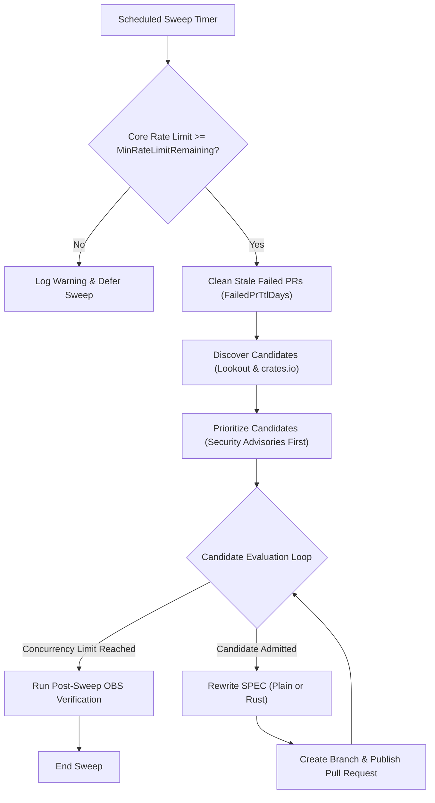

# Package Update Service

Autonomous background worker that periodically polls upstream package releases, evaluates upgrade admission criteria, updates RPM SPEC files, backfills continuous integration checksums, and publishes automated pull requests.

---

## 1. Purpose and Trigger Events

Automates the routine discovery, preparation, and publication of upstream package upgrades for RPM specifications in package repositories. Operates as an independent scheduled background service (`IHostedService`).

### Trigger Mechanism
- Periodic background timer configured by `CheckIntervalHours` (default: every 12 hours).
- Does not rely on incoming webhook events.

---

## 2. Evaluation Logic and Workflow



### Key Functional Behaviors
1. **Admission Rules**: Prevents accidental cross-major SemVer and CalVer breaking changes (`AllowCrossMajorVersion = false`) and skips packages containing downstream `Patch` directives (`SkipPackagesWithPatches = true`). Respects `#!NoAutoUpdate` opt-out tags inside SPEC files.
2. **Spec Version Rewriters**:
   - `PlainSpecVersionRewriter`: Updates `Version:` tokens while keeping `Release:` intact.
   - `RustCrateSpecRewriter`: Synchronizes `Version:` and `%global full_version` for Rust crates.
3. **CI Checksum Backfill**: Detects failed pull requests caused by invalid `#!RemoteAsset` checksums and automatically backfills correct SHA-256 digests.
4. **Failure Cooldown & Tracking**: Tracks consecutive CI failures per package (`MaxConsecutiveFailures`). When the threshold is reached, creates a tracking issue carrying `Auto-Update: Blocked` and `Status: stale-exempt` and enters cooldown for `GiveUpIssueCooldownDays` days (independent of the upstream release stabilization window `CooldownHours`).
5. **Post-Merge OBS Verification**: `ObsPostMergeVerifier` polls Open Build Service (`build.openruyi.cn`) to verify that merged pull request commits build successfully. If `RequireObsSuccessAfterMerge` is enabled and OBS fails, applies `Auto-Update: Blocked`.

---

## 3. Managed Labels and Mutex Group

- `Auto-Update`: Base label applied to all pull requests published by the package update service.
- `Auto-Update: Rust`: Applied to pull requests updating Rust Cargo crates.
- `Auto-Update: Blocked`: Applied to tracking issues when repeated failures occur or to merged PRs failing post-merge OBS verification.
- `Status: stale-exempt`: Applied to tracking issues and pull requests so automated stale sweeps do not close them.

---

## 4. Configuration Options

Configured under the `PackageUpdate` JSON section in `appsettings.json`:

| Parameter | Type | Default | Description |
|---|---|---|---|
| `Enabled` | `bool` | `false` | Master toggle for the package update background service. |
| `DryRun` | `bool` | `true` | When `true`, discovers candidates and rewrites specs in memory without pushing branches, opening PRs, or creating labels on GitHub. |
| `TargetRepository` | `string` | `"openRuyi-Project/openRuyi"` | Target repository to publish pull requests against in `"owner/repo"` format. |
| `BotLogin` | `string` | `"aqua-rium"` | GitHub login used to author automated update pull requests. |
| `BotPat` | `string` | `""` | Optional GitHub Personal Access Token. When empty, falls back to GitHub App authentication. |
| `BranchPrefix` | `string` | `"autoupdate/"` | Prefix prepended to generated git branches. |
| `CheckIntervalHours` | `int` | `12` | Frequency in hours between candidate discovery sweeps. |
| `Lookout` | `LookoutUpdateOptions` | (object) | Configuration for the Lookout upstream candidate discovery service (`lookout.openruyi.cn`). |
| `RustCratePoller` | `RustCratePollerOptions` | (object) | Configuration for the crates.io sparse index poller. |
| `Obs` | `ObsOptions` | (object) | Configuration for post-merge Open Build Service build verification. |
| `AllowCrossMajorVersion` | `bool` | `false` | Whether to permit updates crossing major version boundaries. |
| `SkipPackagesWithPatches` | `bool` | `true` | When `true`, packages with downstream `Patch` directives are skipped. |
| `MaxCandidatesPerSweep` | `int` | `5` | Maximum number of update candidates admitted and published in a single sweep. |
| `MaxConcurrentPullRequests` | `int` | `5` | Maximum open update pull requests allowed simultaneously. |
| `FailedPrTtlDays` | `int` | `7` | Days an inactive pull request with failing CI remains open before automated closure, and maximum age of merged pull requests before unverified branches are reclaimed. |
| `CooldownHours` | `int` | `72` | Minimum age in hours an upstream release must reach before submission. Setting 0 disables the stabilization window. Security advisories bypass this stabilization delay. |
| `MaxConsecutiveFailures` | `int` | `3` | Consecutive failed pull requests before entering cooldown. |
| `IssueOnGivingUp` | `bool` | `true` | Whether to file a tracking issue when a package reaches consecutive failure limits. |
| `GiveUpIssueCooldownDays` | `int` | `30` | Days a package remains in failure cooldown after reaching consecutive CI failure limits. |
| `GiveUpIssueLabel` | `string` | `"Status: stale-exempt"` | Protection label applied to failure tracking issues. |
| `MinRateLimitRemaining` | `int` | `500` | Minimum core GitHub API quota required to begin a sweep. |
| `RequestThrottleMilliseconds` | `int` | `2000` | Delay in milliseconds inserted after publishing each update pull request to prevent secondary rate limits. |

### Nested Options

#### `LookoutUpdateOptions` (`PackageUpdate:Lookout`)
- `Enabled` (`bool`, default: `true`): Toggles Lookout candidate source.
- `BaseUrl` (`string`, default: `"https://lookout.openruyi.cn"`): Base endpoint URL for Lookout API.
- `StaleThresholdHours` (`int`, default: `48`): Freshness threshold in hours for Lookout candidate observations.

#### `RustCratePollerOptions` (`PackageUpdate:RustCratePoller`)
- `Enabled` (`bool`, default: `true`): Toggles crates.io candidate poller.
- `IndexBaseUrl` (`string`, default: `"https://index.crates.io"`): Base URL for crates.io sparse index.
- `MaxCratesPerSweep` (`int`, default: `60`): Maximum crate versions queried per sweep.
- `RequestDelayMilliseconds` (`int`, default: `300`): Inter-query throttle delay for crates.io queries.

#### `ObsOptions` (`PackageUpdate:Obs`)
- `BaseUrl` (`string`, default: `"https://build.openruyi.cn"`): OBS public API endpoint.
- `Project` (`string`, default: `"openruyi"`): Target OBS project name.
- `TargetRepository` (`string`, default: `"riscv64"`): Target OBS repository name.
- `TargetArch` (`string`, default: `"riscv64"`): Target OBS architecture filter.
- `RequireObsSuccessAfterMerge` (`bool`, default: `false`): Applies `Auto-Update: Blocked` if post-merge OBS build does not succeed.

---

## 5. Failure Handling and Fallback Semantics

- **Quota Starvation**: Sweeps defer automatically when remaining GitHub API quota drops below `MinRateLimitRemaining`.
- **Merge Commit Synchronization**: OBS verification checks `_service` revision against the PR's `MergeCommitSha` to avoid checking stale build results before synchronization completes.
- **Fail-Safe Dry Run**: Starts in `DryRun = true` and `Enabled = false` by default.
- **Security Updates Concurrency & Bypass**: Security advisories bypass the `CooldownHours` release stabilization window and possess a dedicated 5-slot concurrency allowance above `MaxConcurrentPullRequests` to prevent starvation by routine updates.
- **Closed-Loop Cooldown Reset**: When a package enters failure cooldown due to consecutive CI failures (`MaxConsecutiveFailures`), cooldown is deterministically reset via two authoritative events:
  1. The tracking issue opened on GitHub is closed by maintainers.
  2. The SPEC file on `main` is manually updated to or past the target version.
  Unstructured issue comments do not unfreeze cooldown to avoid false resets during discussion. If maintainers need to manually unfreeze a package early, simply close the tracking issue or bump the SPEC on main.
- **Merged Branch Reclamation**: Git branches created for pull requests (`autoupdate/<pkg>`) are safely deleted after PR merge once:
  1. Post-merge OBS build verification reports `Succeeded`, or
  2. The merged PR has aged past `FailedPrTtlDays` (preventing branch accumulation for broken OBS builds).
  Branch deletion strictly validates that the branch belongs to the target repository, matches `BranchPrefix`, has no active open PRs reusing it, and has not progressed past the merged PR's head SHA.

---

## 6. Minimal Configuration Example

```json
{
  "PackageUpdate": {
    "Enabled": true,
    "DryRun": false,
    "TargetRepository": "openRuyi-Project/openRuyi",
    "CheckIntervalHours": 12,
    "MaxCandidatesPerSweep": 5,
    "MaxConcurrentPullRequests": 5
  }
}
```
