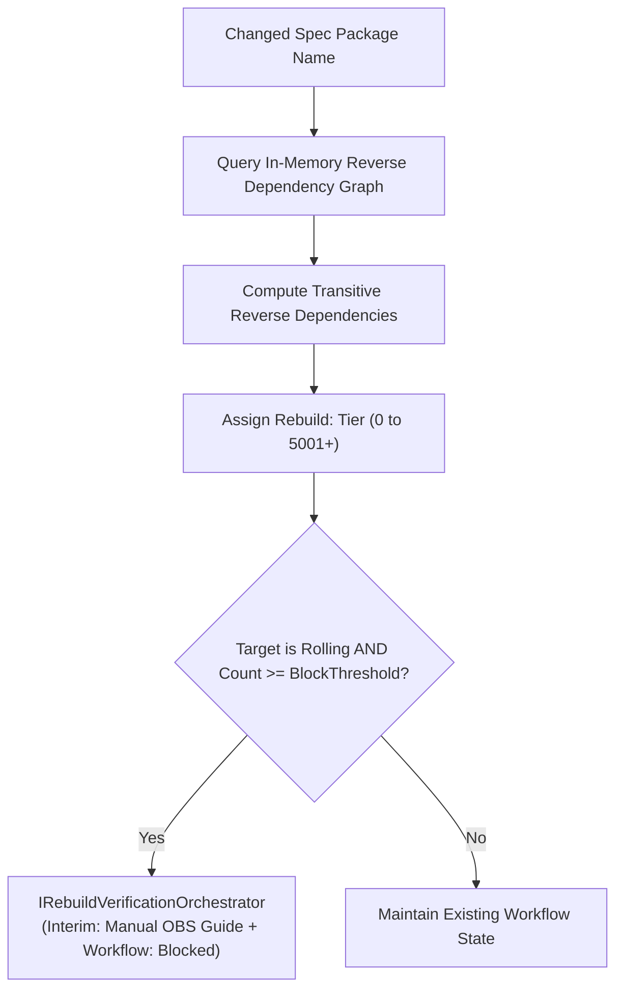

# Rebuild Impact Analysis Module

Analyzes RPM repository metadata (`repodata/primary.xml.gz`) to compute transitive reverse build dependency chains, tags the impact tier, and blocks pull requests when impact exceeds thresholds.

---

## 1. Purpose and Trigger Events

Upgrading foundational packages (e.g. `glibc`, `openssl`, `python`) may require hundreds or thousands of dependent packages to be rebuilt. This module calculates the downstream blast radius and gates merge workflows.

### Trigger Events
- `pull_request` (`opened`, `synchronize`, `reopened`, `ready_for_review`, `edited`)

---

## 2. Evaluation Logic and Workflow



`RebuildImpactModule` delegates gate enforcement and verification workflows through `IRebuildVerificationOrchestrator` (defaulting to `ManualGuideRebuildVerificationOrchestrator`), which returns a `RebuildVerificationResult` carrying a lifecycle `RebuildVerificationState` (`ManualVerificationRequired`, `Pending`, `Passed`, or `Failed`) and an optional `TrackingUrl`. This keeps `IObsBuildService` read-only while leaving a clean extension seam for future bot-driven OBS reverse-dependency automation.

---

## 3. Managed Labels and Mutex Group

### Rebuild Tiers (Single-Choice Mutex)
- `Rebuild: 0`
- `Rebuild: 1-10`
- `Rebuild: 11-100`
- `Rebuild: 101-500`
- `Rebuild: 501-1000`
- `Rebuild: 1001-2500`
- `Rebuild: 2501-5000`
- `Rebuild: 5001+`

### Gating Labels
- `Workflow: Blocked`: Added if dependent package count $\ge 1001$ on `Target: Rolling`.

---

## 4. Configuration Options

Configured under the `RebuildImpact` JSON section:

| Parameter | Type | Default | Description |
|---|---|---|---|
| `Enabled` | `bool` | `true` | Master switch for rebuild impact analysis. |
| `PrimaryXmlUrl` | `string?` | `null` | URL to `repomd.xml` or a `primary.xml(.gz/.zst)` file. When unset, the repository derived from `AbiCompliance:StableRpmBaseUrl` is used; if neither is set, no graph is loaded and no `Rebuild:` label is applied. |
| `LocalCachePath` | `string?` | `null` | Path to a local primary metadata **file** (`.xml` or `.xml.gz`), not a directory. When null, no local snapshot is read. |
| `RefreshIntervalHours` | `double` | `6` | Interval in hours for polling repository repodata updates. |
| `CalculationMode` | `string` | `"Transitive"` | Dependency traversal mode: `"Transitive"` (full closure) or `"Direct"`. |
| `MaxDepth` | `int?` | `null` | Optional ceiling for dependency traversal depth (null is unlimited). |
| `BlockThreshold` | `int` | `1001` | Dependent package count threshold triggering `Workflow: Blocked`. |
| `TargetBranchToBlock` | `string` | `"Rolling"` | Release stream subject to rebuild blocking (`"Rolling"` or `"LTS"`). |
| `VerificationGuideLinks` | `VerificationReferenceLink[]` | `[]` | Max 5 unique `http`/`https` links (`Title`, optional `TitleZh`, `Url`) | Optional "See also" reference links appended below the self-contained OBS reverse-dependency guidance comment; empty emits no external links. |

---

## 5. Failure Handling and Fallback Semantics

- **Missing Repodata**: If the repository primary metadata is not configured or unavailable, the module logs a warning and leaves all `Rebuild:` labels unchanged. It does not assume `Rebuild: 0`.
- **Cycle Detection**: The transitive traversal algorithm maintains visited sets to prevent infinite loops in cyclic dependencies.
- **Invalid Configuration Fail-Fast**: `RebuildImpactOptionsValidator` rejects non-positive intervals, negative block thresholds, invalid `CalculationMode` values, and malformed `VerificationGuideLinks` entries (more than 5 links, blank/multiline/overlong titles, non-HTTP/HTTPS URLs, or duplicate normalized URLs) at startup.
- **Trusted Maintainer Configuration**: `VerificationGuideLinks` comes from maintainer-owned `appsettings.json` (trusted configuration); validation enforces structural bounds while rendering applies minimal link-bracket/newline escaping without over-restricting maintainer-authored titles or URLs.
- **Automated OBS Boundary & State Contract**: `RebuildImpactModule` is stateless with respect to verification lifecycle — persistence, TTLs, restart recovery, retry policies, and manual overrides belong to future automated `IRebuildVerificationOrchestrator` implementations. `ManualVerificationRequired` suppresses duplicate advisory comments when `Workflow: Blocked` is already present, whereas `Pending`/`Failed` transitions post any non-null `AdvisoryComment` updates. Only `RebuildVerificationState.Passed` clears `Workflow: Blocked`.

---

## 6. Minimal Configuration Example

```json
{
  "RebuildImpact": {
    "Enabled": true,
    "BlockThreshold": 1001,
    "TargetBranchToBlock": "Rolling",
    "CalculationMode": "Transitive",
    "VerificationGuideLinks": []
  }
}
```

---

## 7. Relevant Test Suites

- `tests/abaci-bot.Tests/RebuildImpactModuleTests.cs`
- `tests/abaci-bot.Tests/RebuildMetadataRefreshServiceTests.cs`
- `tests/abaci-bot.Tests/RebuildImpactOptionsValidatorTests.cs`
