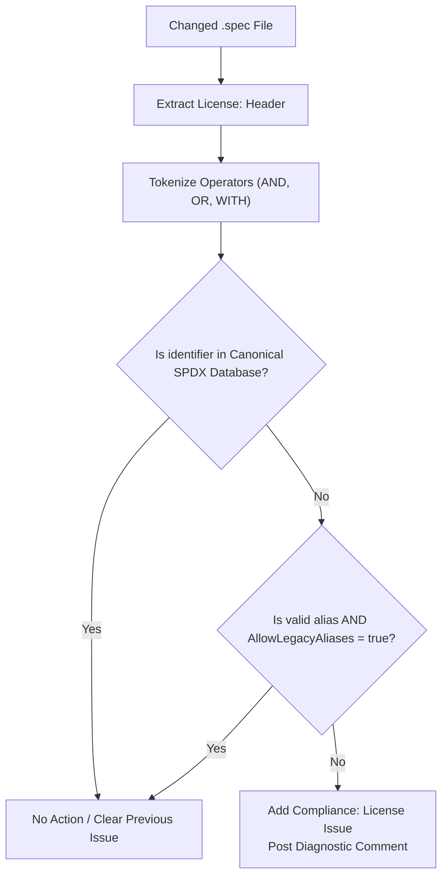

# SPDX License Compliance Module

Validates that `License:` declarations in changed RPM `.spec` files conform to canonical SPDX license expressions.

---

## 1. Purpose and Trigger Events

Maintains legal and open-source license compliance across package repositories by detecting non-standard, deprecated, or invalid license identifiers in package specifications.

### Trigger Events
- `pull_request` (`opened`, `synchronize`, `edited`)

---

## 2. Evaluation Logic and Workflow



---

## 3. Managed Labels

- `Compliance: License Issue`: Applied when one or more license identifiers in changed specs fail SPDX validation.

---

## 4. Configuration Options

Configured under the `SpdxCompliance` JSON section:

| Parameter | Type | Default | Description |
|---|---|---|---|
| `Enabled` | `bool` | `true` | Master switch for the license validation module. |
| `UpdateRemoteUrl` | `string` | `https://spdx.org/licenses/licenses.json` | Canonical SPDX licenses list endpoint. |
| `UpdateExceptionsRemoteUrl` | `string` | `https://spdx.org/licenses/exceptions.json` | Canonical SPDX exceptions list endpoint. |
| `AutoUpdateIntervalHours` | `double` | `24` | Interval in hours between background updates of the local SPDX database. `0` disables periodic refresh. |
| `AllowLegacyAliases` | `bool` | `true` | When `true`, accepts recognized legacy aliases (e.g. `GPLv2+`) without flagging an issue. |
| `MaxDegreeOfParallelism` | `int` | `8` | Maximum concurrent license expressions evaluated in parallel. |

---

## 5. Failure Handling and Fallback Semantics

- **Remote API Unavailability**: If `spdx.org` is unreachable during background updates, the module falls back to its built-in embedded canonical SPDX dataset without interrupting review workflows.
- **Complex Expressions**: Supports compound expressions containing parentheses, `AND`, `OR`, and `WITH <Exception>`.

---

## 6. Minimal Configuration Example

```json
{
  "SpdxCompliance": {
    "Enabled": true,
    "AllowLegacyAliases": true,
    "AutoUpdateIntervalHours": 24
  }
}
```

---

## 7. Relevant Test Suites

- `tests/abaci-bot.Tests/SpdxComplianceModuleTests.cs`

