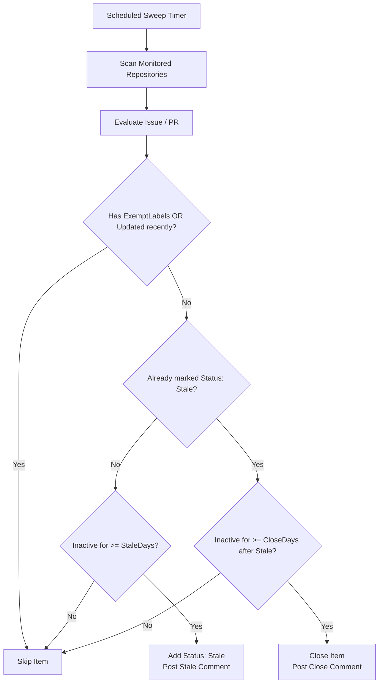

# Stale Lifecycle Service

Runs background evaluation sweeps across monitored repositories to mark and automatically close abandoned issues and pull requests.

---

## 1. Purpose and Trigger Events

Prevents issue trackers and PR queues from accumulating inactive or abandoned items. Operates as an independent scheduled background daemon (`IHostedService`).

### Trigger Mechanism
- Periodic timer configured by `CheckIntervalHours` (default: every 24 hours).
- Does not rely on incoming webhook events.

---

## 2. Evaluation Logic and Workflow



---

## 3. Managed Labels and Mutex Group

- `Status: Stale`: Applied to inactive items after `StaleDays`.
- `Status: stale-exempt`: Protection label. Any item carrying this label (or other labels in `ExemptLabels`) is skipped during evaluation sweeps.

---

## 4. Configuration Options

Configured under the `StaleLifecycle` JSON section:

| Parameter | Type | Default | Description |
|---|---|---|---|
| `Enabled` | `bool` | `false` | Master toggle for the background worker. Must be set to `true` to activate. |
| `DryRun` | `bool` | `true` | When `true`, candidates are logged without mutating labels or closing items. |
| `MonitoredRepositories` | `string[]` | `[]` | Explicit list of repositories in `"owner/repo"` format to scan. |
| `ExcludedRepositories` | `string[]` | `[]` | Repositories explicitly excluded from sweeps. |
| `StaleDays` | `int` | `30` | Inactivity threshold in days before applying `Status: Stale`. |
| `CloseDays` | `int` | `7` | Grace period in days before closing a stale item. |
| `ExemptLabels` | `string[]` | `["Status: stale-exempt", "Workflow: Blocked", "Security", "Epic"]` | Labels exempting an item from stale sweeps. |
| `StaleCommentTemplate` | `string` | Standard message | Notification posted upon marking as stale. Placeholders: `{StaleDays}`, `{CloseDays}`. |
| `CloseCommentTemplate` | `string` | Standard message | Notification posted upon automatic closure. Placeholders: `{CloseDays}`. |
| `CheckIntervalHours` | `int` | `24` | Interval in hours between sweeps. |
| `RequestThrottleMilliseconds` | `int` | `500` | Delay between consecutive API calls to prevent secondary rate limit throttling. |
| `MinRateLimitRemaining` | `int` | `100` | Core API quota threshold; sweeps halt if quota drops below this value. |

---

## 5. Failure Handling and Fallback Semantics

- **Secondary Rate Limit Handling**: If GitHub returns HTTP 403 secondary rate limit headers, the service aborts the current sweep and waits its fixed retry delay (60 s internal). It does not use exponential backoff.
- **Fail-Safe Dry Run**: Starts in `DryRun = true` and `Enabled = false` by default to prevent unintended bulk mutations upon initial deployment.

---

## 6. Minimal Configuration Example

```json
{
  "StaleLifecycle": {
    "Enabled": true,
    "DryRun": false,
    "MonitoredRepositories": [ "openRuyi-Project/openRuyi" ],
    "StaleDays": 30,
    "CloseDays": 7,
    "ExemptLabels": [ "Status: stale-exempt", "Workflow: Blocked" ]
  }
}
```

---

## 7. Relevant Test Suites

- `tests/abaci-bot.Tests/StaleLifecycleServiceTests.cs`
