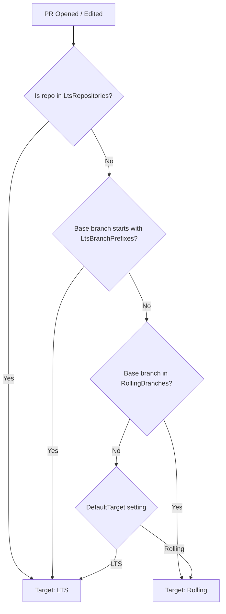

# Target Classification Module

Classifies pull requests into Long-Term Support (`Target: LTS`) or Rolling release streams (`Target: Rolling`) based on base branch naming and repository configuration.

---

## 1. Purpose and Trigger Events

Packages and specifications target different release tracks. This module ensures clear visibility into whether a change affects rolling distributions or stable LTS releases.

### Trigger Events
- `pull_request` (`opened`, `synchronize`, `reopened`, `ready_for_review`, `converted_to_draft`, `edited`)

---

## 2. Evaluation Logic and Workflow



---

## 3. Managed Labels and Mutex Group

### Target Mutex Group (Single-Choice)
- `Target: Rolling`
- `Target: LTS`

---

## 4. Configuration Options

Configured under the `TargetClassification` JSON section:

| Parameter | Type | Default | Description |
|---|---|---|---|
| `LtsRepositories` | `string[]` | `[]` | Repository names where all pull requests are tagged `Target: LTS`. |
| `LtsBranchPrefixes` | `string[]` | `["lts/", "lts-"]` | Branch prefixes classified as LTS release branches. |
| `RollingBranches` | `string[]` | `["main", "master", "rolling"]` | Branch names designated as rolling development streams. |
| `DefaultTarget` | `string` | `"Rolling"` | Fallback classification when base branch matches neither rule. Allowed: `"Rolling"`, `"LTS"`. |

---

## 5. Failure Handling and Fallback Semantics

- **Unknown Branch**: If a contributor targets an unlisted branch (e.g. `feature/experimental`), the module applies `DefaultTarget` (default: `Target: Rolling`).
- **Mutual Exclusivity**: If the PR previously carried `Target: LTS` and is retargeted to `master`, `LabelMutexEngine` strips `Target: LTS` and applies `Target: Rolling`.

---

## 6. Minimal Configuration Example

```json
{
  "TargetClassification": {
    "LtsRepositories": [],
    "LtsBranchPrefixes": [ "lts/", "lts-" ],
    "RollingBranches": [ "main", "master", "rolling" ],
    "DefaultTarget": "Rolling"
  }
}
```

---

## 7. Relevant Test Suites

- `tests/abaci-bot.Tests/TargetClassificationModuleTests.cs`
