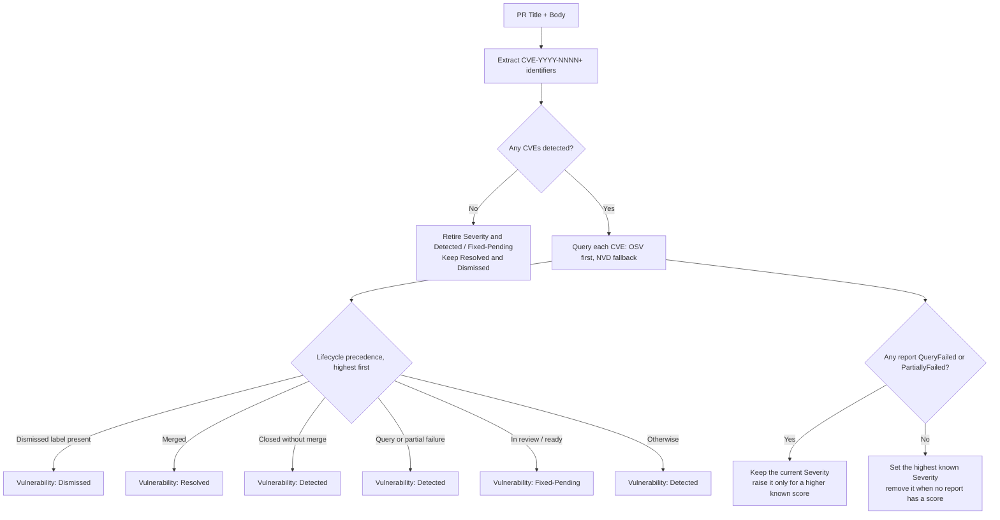

# Vulnerability Detection Module

Detects Common Vulnerabilities and Exposures (CVE) mentions in pull requests, queries upstream vulnerability databases (OSV and NVD), and applies standardized severity and lifecycle labels.

---

## 1. Purpose and Trigger Events

Automates security tracking for any pull request that mentions one or more CVE identifiers. The module is repository-agnostic: it does not filter by repository name or by changed files.

### Trigger Events
- `pull_request` (`opened`, `edited`, `synchronize`, `ready_for_review`, `reopened`, `closed`)

---

## 2. Evaluation Logic and Workflow



Lifecycle and severity are reconciled independently. The lifecycle label is always written on a run that finds a CVE; the severity label follows the right-hand branch above, so an incomplete answer can raise it but never lower or remove it.

### Fail-Safe Handling on Query Failures
When every configured source (OSV and NVD) is unreachable or times out, an open pull request is tagged with `Vulnerability: Detected` (fail-safe posture). This ensures security awareness is never omitted due to transient network failures.

When one source fails and the other answers without a record, the report is marked `PartiallyFailed`; the PR still receives `Vulnerability: Detected`, and the comment states that details may be incomplete.

A merged pull request is labeled `Vulnerability: Resolved` even when the lookup failed during that run, because "the fix landed" is a pull-request fact rather than a lookup result. Only a maintainer-applied `Vulnerability: Dismissed` outranks it.

An incomplete lookup never lowers an existing severity label. A failed query means the score is unknown, not that the CVE has no severity, and the unresolved CVE may be the more severe one. It can still raise the label, because the highest known score is a lower bound: a partially failed lookup that nevertheless resolved one CVE at 9.8 moves `Severity: 2` up to `Severity: 1`. A warning names the CVEs that could not be resolved, and the next complete lookup reconciles the label in both directions.

---

## 3. Managed Labels and Mutex Groups

### Severity Mutex Group (Single-Choice)
- `Severity: 1` (Critical, CVSS 9.0–10.0)
- `Severity: 2` (High, CVSS 7.0–8.9)
- `Severity: 3` (Medium, CVSS 4.0–6.9)
- `Severity: 4` (Low, CVSS < 4.0, including 0.0)

### Lifecycle Mutex Group (Single-Choice)
- `Vulnerability: Detected`
- `Vulnerability: Fixed-Pending`
- `Vulnerability: Resolved`
- `Vulnerability: Dismissed`

---

## 4. Configuration Options

Configured under the `CveSecurity` JSON section:

| Parameter | Type | Default | Description |
|---|---|---|---|
| `Enabled` | `bool` | `true` | Master switch for the CVE security scanning module. |
| `OsvApiBaseUrl` | `string` | `https://api.osv.dev/v1/vulns/` | Base URL for OSV.dev REST API queries. Empty skips OSV; NVD fallback still applies. |
| `NvdApiBaseUrl` | `string` | `https://services.nvd.nist.gov/rest/json/cves/2.0` | Base URL for NIST NVD REST API queries. Empty skips NVD; only OSV is queried. |
| `NvdApiKey` | `string?` | `null` | Optional API key for NIST NVD to permit higher rate limit ceilings. |
| `CacheExpirationHours` | `double` | `12` | Cache TTL in hours for resolved CVE records. |
| `UnknownCacheExpirationHours` | `double` | `1` | Shorter cache TTL in hours for newly published or unindexed records. |
| `RequestTimeoutSeconds` | `double` | `15` | HTTP request timeout in seconds. |

---

## 5. Failure Handling and Fallback Semantics

- **Dual-Source Fallback**: Queries OSV first. If OSV returns no record, no score, or errors, falls back to NVD.
- **Lifecycle Precedence**: maintainer `Vulnerability: Dismissed`, then merged (`Vulnerability: Resolved`), then closed-without-merge (`Vulnerability: Detected`), then lookup failure (`Vulnerability: Detected`), then review state (`Vulnerability: Fixed-Pending`). A merged pull request therefore resolves even when the security databases were unreachable during that run.
- **Reopen Restores Tracking**: a reopened pull request is recomputed from the refreshed state, so it leaves the closed-without-merge branch and returns to `Vulnerability: Fixed-Pending` or `Vulnerability: Detected`.
- **Review State Within One Run**: the review branch reads the workflow labels the earlier workflow module (priority 10) staged in the same run, not only the labels that existed before it. A non-draft pull request that becomes ready for review in this run is therefore tagged `Vulnerability: Fixed-Pending` immediately instead of on the next event. The ordering dependency is not enforced by code: the vulnerability module must stay after the workflow module for this to hold. A later module may still evict the staged review label (for example `Workflow: Blocked` winning the workflow mutex group), in which case the next event corrects the lifecycle label.
- **Fail-Safe Labeling**: If both fail on an open pull request, `Vulnerability: Detected` is applied without a new severity label, an existing `Severity:` label is never lowered, and a warning is logged with the affected CVE identifiers.
- **Complete but empty lookups**: When every configured source answers and none has a record or a score, the severity label is removed, because the absence of a score is then a confirmed fact rather than a lookup failure.
- **CVE Mention Removed**: An edit that removes every CVE identifier from the title and body retires `Severity:` and the active lifecycle states (`Detected`, `Fixed-Pending`). `Resolved` and `Dismissed` are kept, because they record what happened or what a maintainer decided rather than what the current text says.
- **Comment Breakdown**: A per-CVE comment is posted once, on the first run that finds a CVE while the pull request carries no `Vulnerability:` label, and only for `opened` or `edited`. Later runs never post it again.
- **Maintainer Dismissal**: If a maintainer explicitly applies `Vulnerability: Dismissed`, every later processed event preserves it, including a run whose title and body no longer mention a CVE.

---

## 6. Minimal Configuration Example

```json
{
  "CveSecurity": {
    "Enabled": true,
    "NvdApiKey": null,
    "CacheExpirationHours": 12,
    "RequestTimeoutSeconds": 15
  }
}
```

---

## 7. Relevant Test Suites

- `tests/abaci-bot.Tests/VulnerabilityModuleTests.cs`
- `tests/abaci-bot.Tests/CveSecurityServiceTests.cs`


