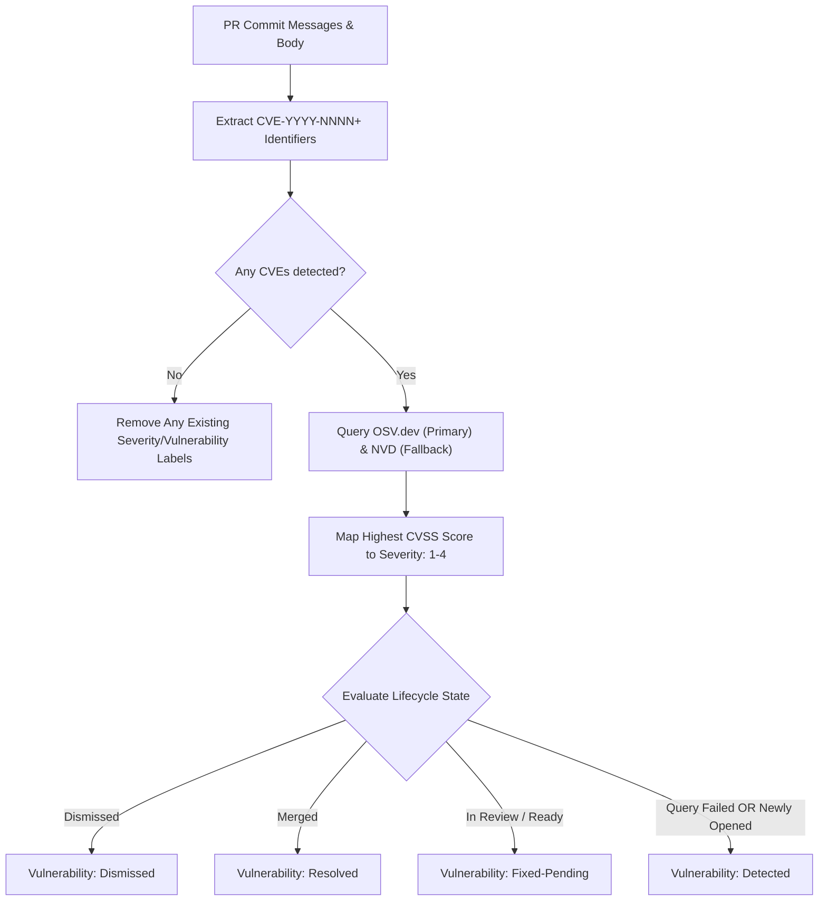

# Vulnerability Detection Module

Detects Common Vulnerabilities and Exposures (CVE) mentions in pull requests, queries upstream vulnerability databases (OSV and NVD), and applies standardized severity and lifecycle labels.

---

## 1. Purpose and Trigger Events

Automates security tracking when security patches or bug fixes are submitted to package repositories.

### Trigger Events
- `pull_request` (`opened`, `synchronize`, `ready_for_review`, `closed`)

---

## 2. Evaluation Logic and Workflow



### Fail-Safe Handling on Query Failures
When both OSV and NVD endpoints are unreachable or timeout, the PR is tagged with `Vulnerability: Detected` (fail-safe posture). This ensures security awareness is never omitted due to transient network failures.

---

## 3. Managed Labels and Mutex Groups

### Severity Mutex Group (Single-Choice)
- `Severity: 1` (Critical, CVSS 9.0–10.0)
- `Severity: 2` (High, CVSS 7.0–8.9)
- `Severity: 3` (Medium, CVSS 4.0–6.9)
- `Severity: 4` (Low, CVSS < 4.0, including 0.0)

### Lifecycle Mutex Group (Single-Choice)
- `Vulnerability: Detected`
- `Vulnerability: Fixed-Pending`
- `Vulnerability: Resolved`
- `Vulnerability: Dismissed`

---

## 4. Configuration Options

Configured under the `CveSecurity` JSON section:

| Parameter | Type | Default | Description |
|---|---|---|---|
| `Enabled` | `bool` | `true` | Master switch for the CVE security scanning module. |
| `OsvApiBaseUrl` | `string` | `https://api.osv.dev/v1/vulns/` | Base URL for OSV.dev REST API queries. Empty skips OSV; NVD fallback still applies. |
| `NvdApiBaseUrl` | `string` | `https://services.nvd.nist.gov/rest/json/cves/2.0` | Base URL for NIST NVD REST API queries. Empty skips NVD; only OSV is queried. |
| `NvdApiKey` | `string?` | `null` | Optional API key for NIST NVD to permit higher rate limit ceilings. |
| `CacheExpirationHours` | `double` | `12` | Cache TTL in hours for resolved CVE records. |
| `UnknownCacheExpirationHours` | `double` | `1` | Shorter cache TTL in hours for newly published or unindexed records. |
| `RequestTimeoutSeconds` | `double` | `15` | HTTP request timeout in seconds. |

---

## 5. Failure Handling and Fallback Semantics

- **Dual-Source Fallback**: Queries OSV first. If OSV returns no record or errors, falls back to NVD.
- **Fail-Safe Labeling**: If both fail, `Vulnerability: Detected` is applied without a severity label, and a diagnostic warning is logged.
- **Maintainer Dismissal**: If a maintainer explicitly applies `Vulnerability: Dismissed`, the bot respects this state on subsequent synchronize events.

---

## 6. Minimal Configuration Example

```json
{
  "CveSecurity": {
    "Enabled": true,
    "NvdApiKey": null,
    "CacheExpirationHours": 12,
    "RequestTimeoutSeconds": 15
  }
}
```

---

## 7. Relevant Test Suites

- `tests/abaci-bot.Tests/VulnerabilityModuleTests.cs`
- `tests/abaci-bot.Tests/CveSecurityServiceTests.cs`


