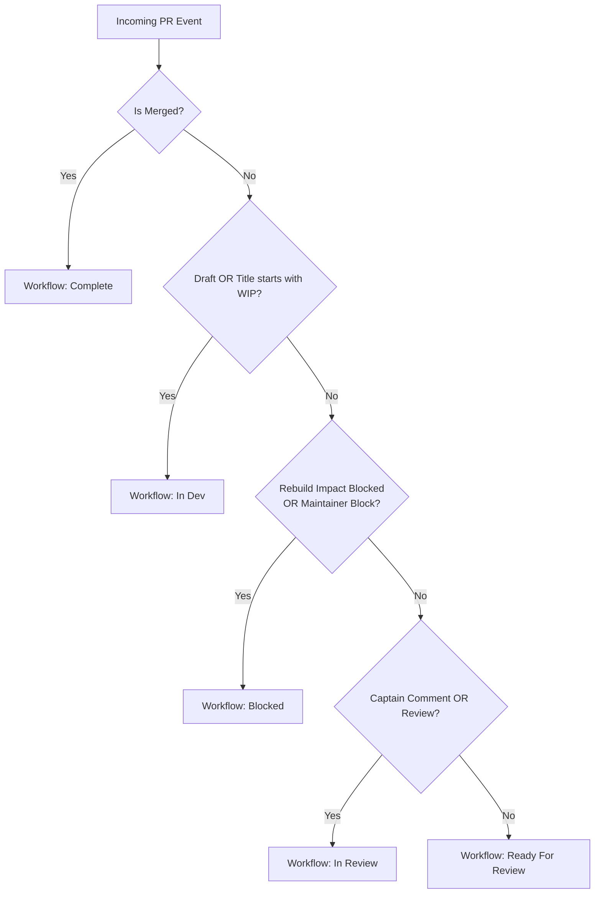

# Workflow State Module

Tracks pull request review lifecycle states, work-in-progress status, maintainer triage, and merge completion. Also covers `ShinyNewPrModule` for initial triage tagging.

---

## 1. Purpose and Trigger Events

`WorkflowStateModule` ensures that every open pull request carries exactly one active workflow status label reflecting its development and review progression.

### Trigger Events
- `pull_request` (`opened`, `reopened`, `closed`, `ready_for_review`, `converted_to_draft`, `synchronize`, `edited`)
- `pull_request_review` (`submitted`, `dismissed`)
- `issue_comment` (`created`)

---

## 2. Evaluation Logic and Workflow



### Shiny New PR Governance (`ShinyNewPrModule`)
- **Trigger**: When a PR is opened, `ShinyNewPrModule` applies `Status: New`.
- **Removal**: Removed upon the first human review or comment from someone other than the author and automated bot accounts.

---

## 3. Managed Labels and Mutex Group

### Workflow Lifecycle (Single-Choice Mutex)
- `Workflow: In Dev`
- `Workflow: Ready For Review`
- `Workflow: In Review`
- `Workflow: Blocked`
- `Workflow: Complete`

### Notification & Status Indicators
- `Status: New`: Managed by `ShinyNewPrModule`.
- `Commits: Updated`: Applied when new commits are pushed to a PR currently in `Workflow: Blocked`. Removed when a Captain responds.

---

## 4. Configuration Options

`WorkflowStateModule` operates using core repository metadata and `GitHubApp:TeamName`. `ShinyNewPrModule` uses `BotDetectionOptions`.

| Parameter | Type | Default | Description |
|---|---|---|---|
| `GitHubApp:TeamName` | `string` | `"captains"` | Team slug whose members are recognized as repository maintainers / Captains. |
| `BotDetection:Whitelist` | `string[]` | See below | List of account usernames ignored during first-response triage evaluations. |

Default bot whitelist:
`["github-actions", "github-actions[bot]", "abaci-bot", "abaci-bot[bot]", "dependabot", "dependabot[bot]", "aqua-rium", "aqua-rium[bot]", "web-flow"]`

---

## 5. Failure Handling and Fallback Semantics

- **Team Membership Lookup Failure**: If GitHub API fails to resolve team members, the module avoids advancing PRs to `In Review` based on unverified accounts and logs a warning.
- **Fail-Fast Label Absence**: If any of the workflow labels do not exist on the target repository, the request aborts fail-fast to alert operators.

---

## 6. Minimal Configuration Example

```json
{
  "GitHubApp": {
    "TeamName": "captains"
  },
  "BotDetection": {
    "Whitelist": [ "github-actions[bot]", "abaci-bot[bot]" ]
  }
}
```

---

## 7. Relevant Test Suites

- `tests/abaci-bot.Tests/WorkflowStateModuleTests.cs`
- `tests/abaci-bot.Tests/ShinyNewPrModuleTests.cs`
- `tests/abaci-bot.Tests/GitHubWebhookProcessorTests.cs`
